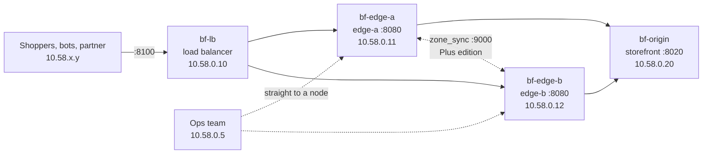

# Side Quest Gauntlet: The Black Friday War Room

Northwind's storefront runs on two NGINX edge nodes behind a load balancer. It's the night before Black Friday, you're on call, and the tickets are starting to come in: wrong prices in the cache, scalper bots, a partner caught in the block, limits that don't hold, and a VIP early-access sale that marketing changes all night long. At midnight the doors open and every fix has to hold under load.

This gauntlet combines the enterprise side quests of three sprints into one session:

| Stage | Sprint | Tickets |
| :--- | :--- | :--- |
| [Stage 1: The Cache](stage-1-cache.md) | 4 (caching) | 1 Wrong price on the doorbuster TV, 2 The whole TV category was repriced, 3 Is the cache earning its keep? |
| [Stage 2: Who Gets In](stage-2-limits.md) | 5 (traffic control) | 4 Scalper bots on checkout, 5 A partner caught in the block, 6 Two nodes, double the limit |
| [Stage 3: Code at the Edge](stage-3-edge-code.md) | 6 (njs) | 7 VIP early access, 8 Should we move to OpenResty? |
| [Finale](finale.md) | all | 9 Midnight |

**Time:** one long session, about 2 to 2.5 hours. **Scoring:** a scoreboard, no clock.

---

## 1. Two Editions

You choose one when you set up. The tickets and the checks are the same; how you solve some of them isn't.

| Ticket | Open source edition (`nginx:mainline`) | NGINX Plus edition |
| :--- | :--- | :--- |
| 1 One wrong price | Refresh a page on demand: `proxy_cache_bypass` for the ops team | `proxy_cache_purge`: `PURGE` for the ops team |
| 2 A whole category | A cache-key generation per section, bumped with a reload | A wildcard `PURGE`, no reload |
| 3 Cache numbers | The cache result in the access log | The NGINX Plus API's cache counters |
| 4 Block a network | `geo` with the list in its own file, applied by a reload | A key-value store changed through the API, synced across nodes, no reload |
| 5 Let one address in | A more specific `geo` entry | A more specific key-value entry, no reload |
| 6 One limit for two nodes | Client affinity at the load balancer | `limit_req` zones synced with `zone_sync` |
| 7 VIP list | njs shared memory and an njs admin endpoint, per node | A synced key-value store keyed by njs's verified member ID |
| 8 njs or Lua? | The same benchmark | The same benchmark |

The open source edition is free for anyone. The NGINX Plus edition needs a license (a trial works). Playing both is the best way to see what Plus actually changes.

---

## 2. What You Need

* **A lab box set up** per the repo's [Getting Started](../../README.md#getting-started): Ubuntu, Docker, `git`, `curl`, `python3`, `jq`. Run as root. Free ports: `8100`, and on the loopback `8020`, `8085`, `8105`.
* **The NGINX Plus edition only:** your license at `~/plus/license.jwt` and the pinned image in `~/plus/plus.env`, per [`docs/nginx-plus-lab.md`](../../docs/nginx-plus-lab.md) section 2. The registry login uses the license, so you only do it once.
* **Comfort with the earlier sprints' core material:** caching (Sprint 4), `limit_req`, `geo` and realip (Sprint 5), and njs basics (Sprint 6). The stage briefings cover the enterprise side and the cluster problems; they don't reteach the basics.

---

## 3. The War Room



| Container | Address | What it is |
| :--- | :--- | :--- |
| `bf-lb` | 10.58.0.10:8100 (host `:8100`) | The load balancer: round robin over both edges, adds the client to `X-Forwarded-For`. Config: `lab/lb/nginx.conf`. |
| `bf-edge-a`, `bf-edge-b` | 10.58.0.11 / .12 :8080 | The two edge nodes, hostnames `edge-a` and `edge-b`. **One config for both:** `lab/edge/nginx.conf` and `lab/edge/shop.js`. Plus edition: the API on :8085 (host `127.0.0.1:8085` for edge-a, `127.0.0.1:8105` for edge-b). |
| `bf-origin` | 10.58.0.20:8020 (host `127.0.0.1:8020`) | The storefront: catalog, product pages, doorbusters, checkout. |
| `bf-client` | 10.58.0.2 | The war room: opens tickets, runs checks, and sends requests from any 10.58.x.y address. |
| `bf-lua` | 10.58.0.30:8080 | OpenResty, for ticket 8 only. |

**Who's who:** shoppers come from `10.58.100.0/24` and other `10.58.x.y` addresses, always through the load balancer. The ops team is `10.58.0.5` and talks straight to a node (`http://edge-a:8080/...`). The bots are `10.58.66.0/24`.

**The storefront:**
* `/catalog/<category>/` and `/catalog/<category>/<sku>` show prices and are cacheable for a day. The categories are `tvs`, `laptops` and `headphones`.
* `/doorbuster/<sku>` is the deals page.
* `POST /checkout` places an order.

**Member cookies:** `nw_member=<id>.<expires>.<signature>`, an HMAC-SHA256 signature with the lab key in `lab/secrets/shop.key`. `shop.js` already verifies them and sets `$member` to the verified ID, or to empty.

**What the edges already do:**
* cache `/catalog/`
* apply realip from the load balancer
* limit `/checkout` to 5 requests/s per client (burst 5) on each node
* pass the verified member ID to the origin on `/doorbuster/`

They send `X-Edge` (which node answered) and `X-Cache-Status` on every response.

---

## 4. Start

```bash
cd /srv/nginx-journey/gauntlet/black-friday/lab
./warroom.sh init oss          # or: init plus. Copies the start files into edge/ and lb/, new scoreboard
./warroom.sh up                # all containers, then the ready check
./warroom.sh check             # before the first ticket: "Black Friday war room is ready to go"
./warroom.sh next              # ticket 1
```

`init` refuses to overwrite your work. `init <edition> --force` starts over, and that also switches editions.

**Each ticket:**
1. `./warroom.sh next` opens it and sets up the incident. For example, it reprices something at the origin after both caches have the old price.
2. Read the ticket in its stage file: what happened, the requirements for your edition, hidden hints, and a hidden answer.
3. Change `edge/nginx.conf`, `edge/shop.js` or `lb/nginx.conf`, then `./warroom.sh reload`. Or use the API. Some tickets forbid a reload in the Plus edition.
4. `./warroom.sh check` checks the ticket, then checks that every solved ticket still holds.

**Scoring:**
* 100 points per ticket, plus 25 if your first `check` solves it.
* 200 for the finale (all of it only if every fix holds and no shopper sees an error).
* 1200 in all.

`./warroom.sh board` shows the board. `./warroom.sh skip` gives up a ticket for no points. Some tickets build on earlier ones: ticket 5 extends ticket 4's denylist, and in the Plus edition ticket 2 uses ticket 1's `PURGE`.

**Reload vs restart:** `./warroom.sh reload` reloads both edges and the load balancer, and tells you if a master refused the new config (it can, after `nginx -t` passed). `./warroom.sh restart` recreates them, which empties the caches and any shared memory. The checks notice restarts.

### Tools

| Command | What it does |
| :--- | :--- |
| `./warroom.sh shop [curl args] PATH` | `curl` through the load balancer as a shopper (`10.58.100.7`) |
| `./warroom.sh ops [curl args] URL` | `curl` as the ops team (`10.58.0.5`), e.g. `http://edge-b:8080/catalog/tvs/` |
| `./warroom.sh from IP [curl args] URL` | `curl` from any `10.58.x.y` address |
| `./warroom.sh token ID [TTL]` | A member cookie value: `./warroom.sh shop -b "nw_member=$(./warroom.sh token alice)" -i /doorbuster/tv-65` |
| `./warroom.sh api edge-a\|edge-b PATH [curl args]` | Plus: a node's API as ops. From the host, `curl 127.0.0.1:8085/api/...` (edge-a) and `127.0.0.1:8105` (edge-b) also work. |
| `./warroom.sh prices` / `stats [PREFIX]` | The origin's current prices / how often each URI reached the origin |
| `./warroom.sh logs edge-a\|edge-b\|lb\|origin` | Follow an error log. Access logs: `lab/logs/<node>/access.log`. |
| `./warroom.sh t` / `T` | `nginx -t` / `nginx -T` in edge-a |
| `./warroom.sh status` / `down` | Ready check / remove everything (your files stay) |

---

## 5. The Quiz

The combined enterprise quiz for Sprints 4–6 covers both editions: [Gauntlet Quiz](../../quiz.html?sprint=6&day=3&pool=gauntlet). Serve the repo first: `cd /srv/nginx-journey && python3 -m http.server 8090`.

---

## 6. Files

| Path | What it is |
| :--- | :--- |
| `lab/warroom.sh`, `lab/warroom.py` | The war room: containers, tickets, checks, scoreboard |
| `lab/origin.py` | The storefront |
| `lab/start/oss/`, `lab/start/plus/` | Start files for each edition (`init` copies them) |
| `lab/edge/`, `lab/lb/` | **Your** working files (gitignored) |
| `lab/openresty/` | The Lua version of ticket 7's logic, for ticket 8 |
| `lab/solution/oss/`, `lab/solution/plus/` | Reference solutions. **Spoilers.** |
| `notes.md` | What building and rehearsing this gauntlet turned up |
