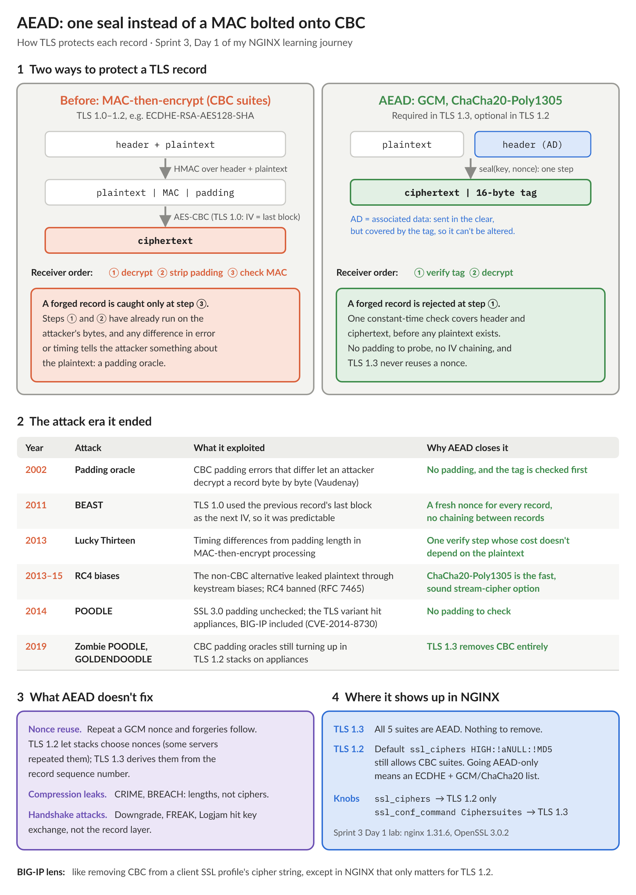

# NGINX Learning Journey, Sprint 3 Day 1: TLS termination at the edge

Sprint 3 moves the Lumina gateway behind TLS. Day 1 covered termination: protocols, ciphers, dual certificates, SNI and session resumption. Most of my questions weren't about directives, though. They were about who actually does the crypto, and that turned into a sidebar on patching before I'd left concept 1.1.

## NGINX has no crypto stack of its own

On BIG-IP, the TLS stack and the client SSL profile both come from F5. NGINX only brings the profile. The package links the system's `libssl.so.3` and `libcrypto.so.3` at runtime, so the handshake, the ciphers and the certificate checks all belong to OpenSSL. NGINX owns the policy and the plumbing: it turns directives into OpenSSL settings, picks the `server` from SNI, chooses ALPN, and runs the shared session cache, ticket keys, OCSP fetching and the QUIC transport.

The handoff runs in layers, and whatever is set last wins:

1. **Ubuntu's build** compiles in a floor: security level 2.
2. **`/etc/ssl/openssl.cnf`** loads at NGINX startup and sets `system_default` to `@SECLEVEL=2`.
3. **NGINX's own directives** are applied to each TLS context.

That's why TLS 1.0/1.1 have two gates. The 1.31.6 default `ssl_protocols` refuses them (alert 70), and OpenSSL 3.x only allows them at security level 0. Opening `ssl_protocols` alone still failed. Any one of these then unlocked both versions:

| Where | Change | Scope |
| :--- | :--- | :--- |
| NGINX | `ssl_ciphers DEFAULT@SECLEVEL=0;` | That context |
| NGINX | `ssl_conf_command CipherString DEFAULT@SECLEVEL=0;` | That context |
| System | Your own `openssl.cnf`, via `OPENSSL_CONF=` | That process |
| System | Edit `/etc/ssl/openssl.cnf` | Every OpenSSL program on the host. Don't. |

## The real lesson: patching and SBOM

If NGINX's TLS is the system's OpenSSL, then patching the host *is* patching NGINX's TLS. That needs more attention than I'm used to giving it. Three things I learned the hands-on way:

- **The version string lies, on purpose.** Ubuntu 22.04 backports fixes into OpenSSL 3.0.2 for its whole life, so `openssl version` and `nginx -V` say `3.0.2 15 Mar 2022` before and after a patch. The real patch level is the package revision. My lab box had NGINX 1.31.6, the current release, on `libssl3` `3.0.2-0ubuntu1.10`, about 20 security revisions and three years behind `1.30`. `nginx -V`'s "built with" line is build-time information anyway.
- **A reload doesn't load the patched library.** After `apt`, `/proc/<pid>/maps` showed `libssl.so.3 (deleted)` for the master and the workers. A reload gave me brand-new workers that still had the old library, because they're copies of the old master. `kill -USR2` re-executes the binary with the new library, with both generations serving until `WINCH` drains the old workers and `QUIT` retires the old master. Until that last `QUIT`, `HUP` to the old master is the rollback. I did the whole sequence without ever stopping NGINX.
- **The detection tools need care.** `/proc/<pid>/maps` is the ground truth, but grep for `lib(ssl|crypto).*(deleted)`. A bare `(deleted)` also matches NGINX's shared memory zones and each worker's AIO mapping. `lsof +L1` misses libraries that are only loaded into memory, not open as files (`lsof -nP | grep DEL` catches them). `needrestart` didn't flag an NGINX I'd started from a shell.

For the SBOM, the packaged NGINX inherits the host's `libssl3`. A container image carries its own OpenSSL, so you rebuild or re-pull it. A `--with-openssl=` build compiles OpenSSL in, so you rebuild NGINX, and package scanners may not see it at all. Scanners that compare upstream versions will also flag CVEs Ubuntu has already fixed.

## Post-quantum needs a newer OpenSSL than this box has

Concept 1.2 says post-quantum hybrids like `X25519MLKEM768` need OpenSSL 3.5. Ubuntu 22.04 and 24.04 can't get there with `apt` (3.0.2 and 3.0.13). 26.04 ships 3.5. Swapping the system library by hand would break everything else that uses it. The official `nginx:mainline` image (Debian 13, OpenSSL 3.5) negotiated `X25519MLKEM768` with no NGINX configuration at all, while my host's 3.0.2 client fell back to plain `X25519`. The price is size: the hybrid key shares were 1216 and 1120 bytes, against 32 for X25519. The certificate is still classical, because only the key exchange is post-quantum.

That decided something for the rest of the journey: **from Sprint 4, the labs run in containers**, so I get current crypto and packages without fighting the host.

## AEAD, and what it ended

The short version: CBC suites decrypt and process padding *before* they can tell a record is forged, and a decade of attacks lived in that gap (padding oracles, BEAST, Lucky Thirteen, POODLE, including the TLS variant that hit BIG-IP as CVE-2014-8730). AEAD checks the tag first, with no padding and no IV chaining. TLS 1.3 only allows AEAD, but TLS 1.2 still depends on your `ssl_ciphers`, and NGINX's default `HIGH:!aNULL:!MD5` still allows CBC.

## Two cipher knobs, and `ssl_conf_command`

`ssl_protocols` and `ssl_ciphers` aren't a matched pair. They're separate filters, and a handshake needs a protocol and a suite that's valid for it. `ssl_ciphers ECDHE+AESGCM` alone still left TLS 1.0 refused by the default `ssl_protocols`. The real couplings are subtler: `@SECLEVEL` lives in the cipher string but gates protocols, and an AEAD-only TLS 1.2 list leaves TLS 1.0/1.1 with no usable suite. The lab's `ssl_protocols TLSv1.2 TLSv1.3` only restates today's default, which pins the policy instead of trusting version defaults.

I'm not sold on `ssl_conf_command`. It passes settings straight to OpenSSL, so TLS 1.3 suites live in a different syntax from everything else. What I verified:

- A typo fails `nginx -t` with OpenSSL's own error. Good.
- It's applied after the native directives. `ssl_conf_command CipherString` beat `ssl_ciphers` regardless of file order.
- **It inherits like `add_header`.** `Ciphersuites` at `http`, plus *any* `ssl_conf_command` in a `server` block, silently dropped the TLS 1.3 policy, and AES-128 was accepted again.

My rule: all TLS policy in one snippet included at `http`, the nearest thing to a parent client SSL profile, and never `ssl_conf_command` below it.

## The lab

- **Dual certificates** are two `ssl_certificate` pairs in one `server`. RSA-only clients failed with alert 40 until the RSA pair was added, and modern clients kept getting ECDSA.
- **SNI:** before a catch-all, NGINX served the Lumina certificate to any name, or none at all. `s_client -verify_hostname` reports `hostname mismatch` but still completes the handshake, where `curl` aborts. An `ssl_reject_handshake` default server (no certificate needed) refuses with alert 112. Connecting by IP sends no SNI, so it's refused too. An IP-based health monitor would mark the node down.
- **Resumption:** tickets work with zero config, but not across a reload, because the ticket keys are regenerated. A shared cache fixes that only where the **default server** can see it, so session settings belong at `http` level.

| Config | Resumes | After reload |
| :--- | :--- | :--- |
| Defaults (tickets on, no cache) | Yes | No |
| Shared cache at `http` level | Yes | Yes |
| Shared cache only in `server lumina.local` | Yes | No |

## Lab notes

- Run the Lab Setup block first. Skipping its `mkdir` of `temp/` fails `nginx -t` with `mkdir() ".../temp/client" failed`.
- `grep: logs/error.log: binary file matches`: a client whose own OpenSSL refuses TLS 1.1 still opens TCP and sends a TLS alert. Mine went to the plain-HTTP port, where NGINX logged the raw bytes as a request line. `grep -a` fixes it.
- Guide fixes along the way: `grep -a` in 3.3, an `hs` helper that now shows `VERIFY FAILED: <reason>`, and no calendar dates in the guide headers.

I scored 9 out of 10 on the quiz on the first try. Next up, Day 2: ALPN, HTTP/2 and HTTP/3.

#NGINX #F5 #TLS #PostQuantum #LearningInPublic #DevOps
