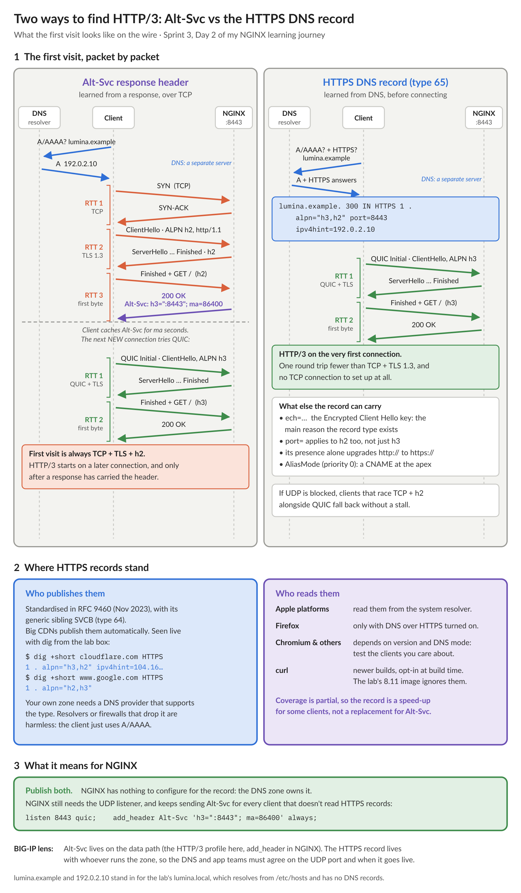

# NGINX Learning Journey, Sprint 3 Day 2: ALPN, HTTP/2 and HTTP/3

Day 2 put HTTP/2 and HTTP/3 in front of the Lumina gateway. The config side is small: `http2 on`, a `quic` listener and an `Alt-Svc` header. The interesting parts were what changes on the wire, which side keeps which state, and how a client finds HTTP/3 in the first place. One QUIC test also took my lab box down, and the server wasn't at fault.

## Two protocol decisions, not one

On BIG-IP, the HTTP/2 profile sits on the client side of a full proxy, and the server side is configured separately. NGINX works the same way. ALPN in the TLS handshake picks `h2` or `http/1.1` for the client, and only on a `server` with `http2 on`. `proxy_http_version` picks what goes upstream. My Sprint 2 mocks saw HTTP/1.1 whether the client spoke h1, h2 or h3.

Multiplexing showed clearly in the access log. Three 2-second requests over HTTP/2 shared one connection (`reqs=1,2,3`) and finished in about 2 seconds. HTTP/1.1 needed three connections to match that, or took 6 seconds on one.

The journal asked how many TLS handshakes a page with 80 assets costs. I first answered a different question: 80 ÷ 6 ≈ 13 is requests per connection, not handshakes. Handshakes equal connections: up to 6 per host on HTTP/1.1, 1 on HTTP/2. HTTP/2 can do better still with **connection coalescing**. If a second hostname resolves to the same IP and the certificate covers both names, the browser reuses the connection it already has. If the server doesn't serve that name, it answers `421 Misdirected Request`.

## HPACK: where the compression lives

HPACK has two parts:

- **Huffman coding** with one fixed table, built from real header statistics. Common characters cost 5 bits. The 600-byte test header of `a`s became 375 bytes, so the first request logged `len=422` against HTTP/1.1's 695.
- **A dynamic table** of headers already sent on the connection. The repeat request cost `len=11`.

The table is fixed on purpose. SPDY compressed headers with DEFLATE, and CRIME recovered secret cookies from the compressed lengths.

Where does the dynamic table live? Each direction of each connection has two copies: the sender's encoder table and the receiver's decoder table. Neither is ever sent. Each header block carries "add this" or "use entry 62" instructions that both sides apply, so the copies stay identical. In NGINX the tables belong to the connection, inside the worker that owns it. They're not a shared zone, and they're gone when the connection closes.

Testing with a Python HTTP/2 client turned up an asymmetry: **NGINX uses the dynamic table for requests but not for responses.** Its first response header block sets its own table size to 0. The response header blocks were 120, 119 and 119 bytes, and the client's decoder table stayed empty. Requests carry the repeated cookies and tokens, so that's where compression pays. And the mobile client on a slow uplink gains most, because request headers go up.

## QUIC fixes the head-of-line blocking HTTP/2 couldn't

HTTP/2 removed head-of-line blocking at the HTTP layer, but TCP still holds back every stream behind one lost packet. QUIC keeps a separate order for each stream and encrypts each packet on its own, so a loss stalls only the streams it carried. HTTP/3 replaces HPACK with **QPACK**, because a table that assumes in-order arrival would bring the blocking back. What QUIC doesn't fix: ordering within one stream, a congestion window shared by every stream, and networks that block UDP, where clients fall back to TCP.

## How a client finds HTTP/3



`Alt-Svc: h3=":8443"` arrives in a response, so the first visit is always TCP + TLS + h2, and QUIC starts with a later connection. An **HTTPS DNS record** (RFC 9460) is fetched with the A/AAAA lookup, so the first connection can be QUIC, one round trip faster. It also carries the Encrypted Client Hello key, which is the main reason the record type exists. NGINX has no part in it, because the DNS zone owner controls it. Client support is still partial, so publish both. The lab's `h3alt` helper showed the Alt-Svc pattern: request 1 over HTTP/2, request 2 over HTTP/3.

## The default server is per socket

TCP 8443 and UDP 8443 are different sockets, each with its own default server. Day 1's `ssl_reject_handshake` catch-all only had a TCP listener, so over QUIC an unknown name was answered with the Lumina certificate and a `200`. The fix is a QUIC listener on the catch-all too:

```nginx
server {
    listen 8443 ssl default_server;
    listen 8443 quic reuseport default_server;
    ssl_reject_handshake on;
}
# lumina.local:  listen 8443 quic;   (reuseport may appear once per address:port)
```

## The test that took my box down

Right after that fix, one HTTP/3 check against the refused name hung my session, then the shell, then SSH, and the instance had to be powered off. NGINX was idle the whole time. The HTTP/3 client was the problem. The quiche-based curl in `alpine/curl-http3:8.11.0` retried the refused handshake about 130 times a second, at 100% CPU and with about 130 MB/s of memory growth. A box with 7.5 GB and no swap lasts about a minute. Once reproduced in a container with a 512 MB limit, it was killed after 4 seconds. The lab helper now gives every HTTP/3 test container a memory limit and `--max-time`.

It's a lesson that applies beyond labs: a client that retries a refused handshake in a tight loop is a self-inflicted denial of service, and test tools need resource limits as much as servers do.

I scored 9 out of 10 on the quiz on the first try. Next up, Day 3: security headers, the sprint lab and the enterprise side quests.

#NGINX #F5 #HTTP2 #HTTP3 #QUIC #LearningInPublic #DevOps
