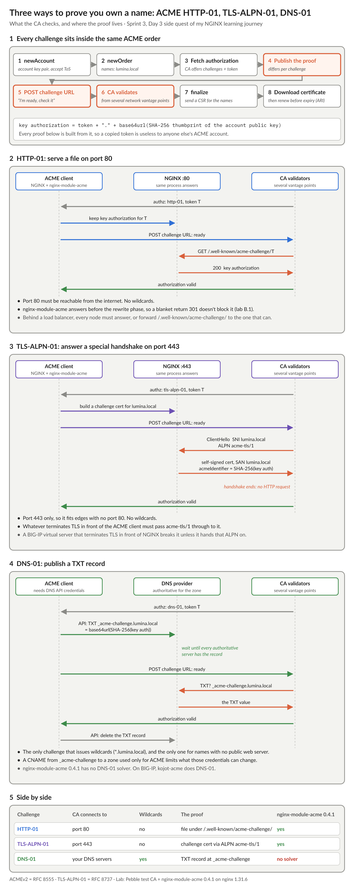

# NGINX Learning Journey, Sprint 3 Day 3 Side Quest: Certificates Without Reloads, Certificates Without Humans

Public certificate lifetimes are shrinking by industry rule: 200 days now, 100 in 2027 and 47 in 2029, and some CAs already offer 6-day certificates. Renewal is turning from a yearly change window into a background job that runs all the time. That raises two questions: where does the certificate come from, and how does it get into the running proxy? The side quest answered each one in a different way.

## Certificates as data, not files (NGINX Plus)

On Day 1, certificates were files named in the config, so changing one meant a reload. NGINX Plus can keep a certificate in a key-value store in shared memory instead, written through its REST API. The config just says `ssl_certificate data:$value`, and NGINX reads that value on every handshake.

I rotated a certificate while a client kept handshaking: no failed handshakes, no reload, the same worker processes. On BIG-IP, updating the cert and key in an SSL profile is a live change too, so this felt familiar. The difference is in how you make the change safely:

- **The API has no transactions.** There's nothing like iControl REST's transaction endpoint, and no conflict detection: if two writers update the same key, the last one wins. Each single write is atomic, though, so the fix is in the design. **The private key and certificate go into one value**, so a rotation is one write and never pairs a new certificate with the old key.
- **An empty store means failed handshakes,** not a fallback certificate. Plan for the first start.
- **The key lives in more places than you'd think.** It's in shared memory, in the optional state file, and behind the API. Even a *read-only* API returns the PEM, so anyone allowed to open the dashboard can download your private keys. In production, I'd keep the key in a secrets manager or HSM, push it in after every start, and lock the API down hard.

## An ACME client inside NGINX

`nginx-module-acme` is F5's open source ACME client, built as an NGINX module, and it works with open source NGINX and NGINX Plus alike. You declare the CA and ask for a certificate in the `server` block. NGINX then creates the account, answers the challenge, collects the certificate and renews it. I ran it against Pebble, Let's Encrypt's test CA, on a private lab box.

What stood out:

- **It answers HTTP-01 challenges itself,** before any rewrite. A blanket `return 301` to HTTPS doesn't get in the way.
- **Renewals go live without a reload as well.** I set up a test CA to issue 3-minute certificates and watched a renewal happen: zero failed handshakes, the same workers, and the next renewal scheduled straight away. The timing follows the CA's suggested renewal window (ACME Renewal Information).
- **It's ACMEv2 (RFC 8555) only,** which is all any CA speaks now. It supports HTTP-01 and TLS-ALPN-01, but not DNS-01, so no wildcards.

The three challenge types make different demands on a network:

- **HTTP-01** needs port 80 open to the internet.
- **TLS-ALPN-01** works on 443 alone, but every TLS terminator in front of the client has to pass the `acme-tls/1` ALPN through. A BIG-IP terminating TLS in front of NGINX breaks it.
- **DNS-01** is the only one that issues wildcards, at the cost of keeping DNS API credentials on the box.

For the BIG-IP side, Kevin Stewart at F5 built [kojot-acme](https://github.com/f5devcentral/kojot-acme), an ACMEv2 client that runs on the BIG-IP itself, with all three challenge types.

## Two halves of one job

ACME gives you the certificate. The Plus key-value store gives you a way to put *any* certificate into a running proxy: one from an internal PKI, an OV certificate, or a wildcard obtained elsewhere. The two don't plug into each other inside NGINX, but together they make a clean pipeline: an external ACME client or enterprise CA issues the certificate, and automation pushes it through the API. That's a pattern I'll come back to when the journey reaches automation.

Quiz: 9 out of 10 on the first try. The miss was a detail I'll remember now: a relative `state_path` resolves against the package's own directory, not NGINX's `-p` prefix, so use an absolute path.

That's Sprint 3: TLS, HTTP/2 and HTTP/3, security headers, and certificates that look after themselves. Sprint 4 starts tomorrow: caching and performance.

#NGINX #F5 #TLS #ACME #PKI #Automation #LearningInPublic #DevOps
