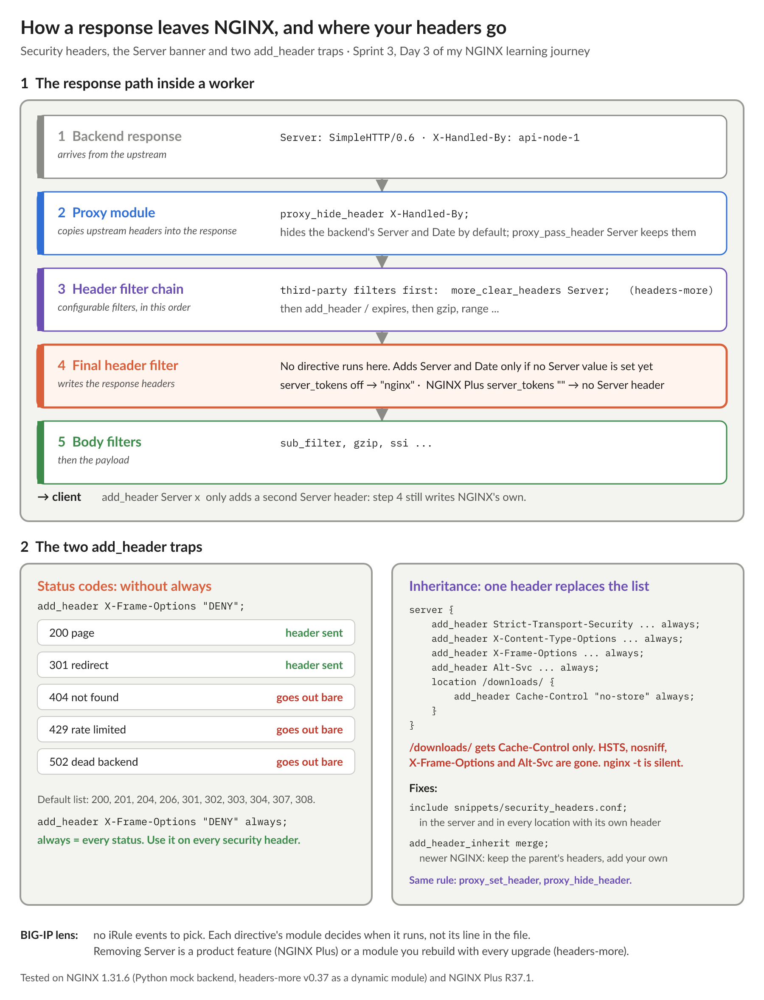

# NGINX Learning Journey, Sprint 3 Day 3: Security Headers and the Lumina Edge

Day 1 locked down TLS, and Day 2 added HTTP/2 and HTTP/3. Day 3 covered what the browser is told once the page arrives: HSTS, `nosniff`, `X-Frame-Options`, and not leaking what's running behind the edge. Adding a header in NGINX takes one line. Making sure it lands on every response took most of the day.

## Where a response actually goes

On BIG-IP I think in iRule events: change the request in `HTTP_REQUEST`, the response in `HTTP_RESPONSE`, and so on. NGINX has no event list to choose from. Each directive belongs to a module, and the module decides when it runs. A request walks fixed phases, from rewrite to access to content. A response passes through filter chains. Where a directive sits in the file doesn't decide when it runs. `deny all; return 200;` in one location returns 200, because `return` runs in the rewrite phase, before any access check.

That model answered a question I had about the `Server` header. `server_tokens off` hides the version, but no open-source directive removes the header. NGINX writes `Server` in the very last header step, after every configurable filter has run, and only if nothing has claimed it yet. That makes three ways around it:

- **`proxy_pass_header Server`** passes the backend's value through, and NGINX adds none of its own. That only helps on proxied responses.
- **headers-more** (`more_clear_headers Server`) is a third-party header filter. It claims the value early and marks it "don't send". It's a module you have to rebuild for every NGINX version.
- **NGINX Plus** `server_tokens ""` removes the header and also drops "nginx" from the built-in error pages.

Adding your own `add_header Server ...` doesn't replace anything. You get two `Server` headers.

## The two traps in `add_header`

Both came up in my quiz review, and both pass `nginx -t` without a warning:

- **Status codes.** Without `always`, `add_header` only applies to success and redirect codes. A 404, a 429 from the rate limiter or a 502 from a dead backend goes out with no security headers at all. Use `always` on every security header.
- **Inheritance.** A location that sets even one `add_header` drops everything it would have inherited. One `Cache-Control: no-store` on a downloads path quietly removed HSTS, `nosniff`, `X-Frame-Options` and the `Alt-Svc` that advertises HTTP/3. `proxy_set_header` and `proxy_hide_header` follow the same rule.

There are two fixes. One is an `include` snippet that holds the full header list, used in the server and in every location that adds its own header. The other is the newer `add_header_inherit merge`, which keeps the parent's headers and adds the child's. Snippets also make the config easier to read: one file per purpose (security headers, API proxy settings), included only where it applies. The plain-HTTP redirect server doesn't get HSTS, because browsers ignore it over HTTP anyway.

## Putting the sprint together

The sprint lab brought all three days together on the Lumina edge:

- TLS 1.2 and 1.3 only, with AEAD ciphers;
- ECDSA and RSA certificates served side by side;
- session resumption that survives a reload;
- HTTP/2, plus HTTP/3 advertised to clients;
- a catch-all that refuses unknown names over both TCP and QUIC;
- security headers on every response.

My first test run passed 8 of 13 checks. I'd missed:

- the WebSocket upgrade `map`;
- the separate default servers: one for the plain-HTTP redirect, and one that refuses handshakes with an unknown name or no SNI;
- the health check endpoint, which I hadn't built yet.

Working through those was worth it. NGINX syntax is a beast, and troubleshooting one flat file is hard, but the `nginx -t` error messages are good: they name the problem, the file and the line.

I scored 7 out of 10 on the quiz on the first try and 9 out of 10 on the second. The misses were all inheritance and `always`, the details that look like nothing until a 502 goes out without HSTS.

Next up: the enterprise side quest, with certificates that rotate without a reload and ACME issuance inside NGINX. It gets a recap of its own.

#NGINX #F5 #WebSecurity #HSTS #TLS #LearningInPublic #DevOps
