# Cache Under Pressure

**Sprint 4 · Day 2.** Which path a request takes through `proxy_cache` when entries are missing, expiring or failing, what the client, NGINX and the origin each do, and the `X-Cache-Status` each path ends in.

* [Part 1: Decision flow](#part-1-decision-flow)
* [Part 2: Who does what, by configuration](#part-2-who-does-what-by-configuration)

---

## Part 1: Decision Flow

Green outcomes answer the client from a cached copy with no origin wait. Amber outcomes waited on an origin round trip. Red outcomes pass an origin error to the client.

### 1. Lookup, and What Happens on a Miss

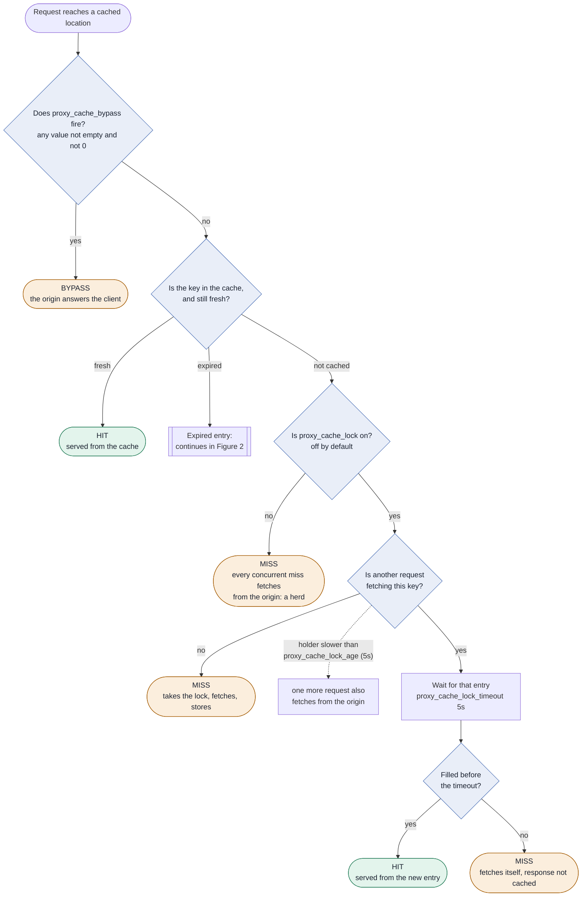

The lock only collapses requests for entries that don't exist yet. A bypassed response can still be stored unless `proxy_no_cache` also fires, which is why Day 1 paired the two for `Authorization`. On every miss there is nothing stale to fall back on, so an origin failure here reaches the client.

### 2. An Expired Entry

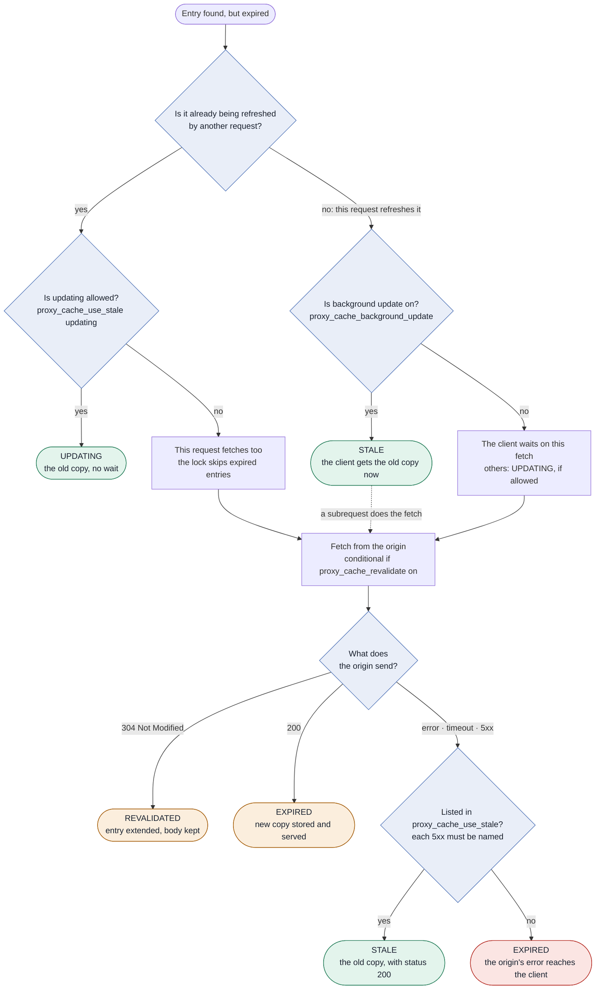

`updating` spares the other requests and background update spares the refresher too, so with both on, nobody waits on a slow origin while a stale copy exists. The origin can switch on the same branches with `stale-while-revalidate` (as `updating`) and `stale-if-error` (as `error timeout`, never a 503 answer), at lower priority than your config. Background update does nothing unless `updating` is listed. In a background refresh, the origin's answer only changes the stored entry: the client already left with `STALE`, and `REVALIDATED` is logged only with `log_subrequest on`.

### Reading X-Cache-Status

| Status | Path that produced it | Origin contacted for this request? |
| :--- | :--- | :--- |
| `HIT` | Fresh entry, or filled while waiting on the lock | No |
| `UPDATING` | Expired entry that another request is refreshing; `updating` allowed | No |
| `STALE` | Background update served the old copy, or the origin failed with a listed condition | No wait for the client. A background subrequest may be fetching. |
| `MISS` | No entry: no lock, the lock holder, or a waiter that timed out | Yes |
| `EXPIRED` | Expired entry refreshed in the foreground, with a new 200 or a passed-through error | Yes |
| `REVALIDATED` | Conditional refresh answered 304 | Yes, with no body |
| `BYPASS` | `proxy_cache_bypass` fired | Yes |

### What to Watch in Monitoring

* A burst of `MISS` or `EXPIRED` for one key right after expiry or a deploy is the herd. The lock fixes the `MISS` burst and `updating` fixes the `EXPIRED` burst.
* With background update on, `STALE` also appears in normal operation, on the first request after every expiry. An outage looks like a sustained `STALE` rate while `$upstream_status` shows errors.
* A slowest response near 5 seconds for a key that should collapse means waiters are hitting `proxy_cache_lock_timeout`. That's when the origin is slower than the lock.

---

## Part 2: Who Does What, by Configuration

The same rules as sequences. Each diagram adds one directive to the one before it, except the failure cases at the end. Time runs down the page; the notes on the left say when each answer arrives. Dashed arrows are answers; a `Bg` arrow is NGINX's background subrequest.

| Scenario | Origin requests | Who waits | Log shows |
| :--- | :--- | :--- | :--- |
| [1. No protection](#1-no-protection) | 20 | All 20, full origin time | `20 MISS` |
| [2. Lock, fast origin](#2-lock-origin-faster-than-the-lock) | 1 | All 20, about the origin time | `1 MISS, 19 HIT` |
| [3. Lock, origin slower than 5 s](#3-lock-origin-slower-than-the-lock) | 20 | 1 for 7 s, 19 for 12 s | `20 MISS` |
| [4. Expired, lock only](#4-expired-entry-lock-only) | 20 | All 20 | `20 EXPIRED` |
| [5. + use_stale updating](#5-stale-while-one-request-refreshes) | 1 | Only the refresher | `1 EXPIRED, 19 UPDATING` |
| [6. + background_update](#6-nobody-waits) | 1 (subrequest) | Nobody | `1 STALE, 19 UPDATING` |
| [7. + revalidate](#7-revalidation) | 1, a 304 with no body | Nobody | `STALE` |
| [8. Origin 503, not listed](#8-origin-fails-condition-not-listed) | 1 | Client, then gets the 503 | `EXPIRED`, 503 |
| [9. Origin 503, listed](#9-origin-fails-condition-listed) | 1 | Client, until the origin fails | `STALE`, 200 |

### 1. No Protection

```nginx
proxy_cache lumina;   # nothing else (Day 1 config)
```
A URL nobody has requested yet, 20 clients at once, a 2-second origin.

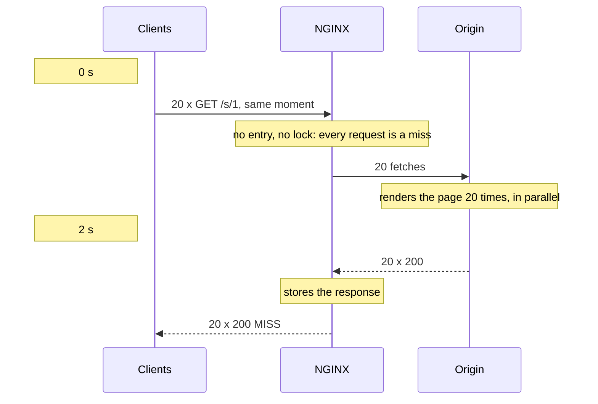

**Origin:** 20 requests for one page. **Waits:** all 20, the full origin time. **Log:** 20 `MISS`.

### 2. Lock, Origin Faster Than the Lock

```nginx
proxy_cache_lock on;   # timers: 5 s
```
Same burst, a new URL, a 2-second origin.

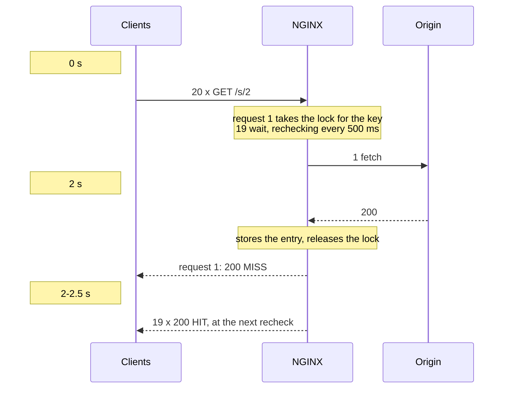

**Origin:** 1 request. **Waits:** all 20, about the origin time. **Log:** 1 `MISS`, 19 `HIT`.

### 3. Lock, Origin Slower Than the Lock

```nginx
proxy_cache_lock on;   # lock_timeout 5s, lock_age 5s
```
Same burst, a new URL, a 7-second origin.

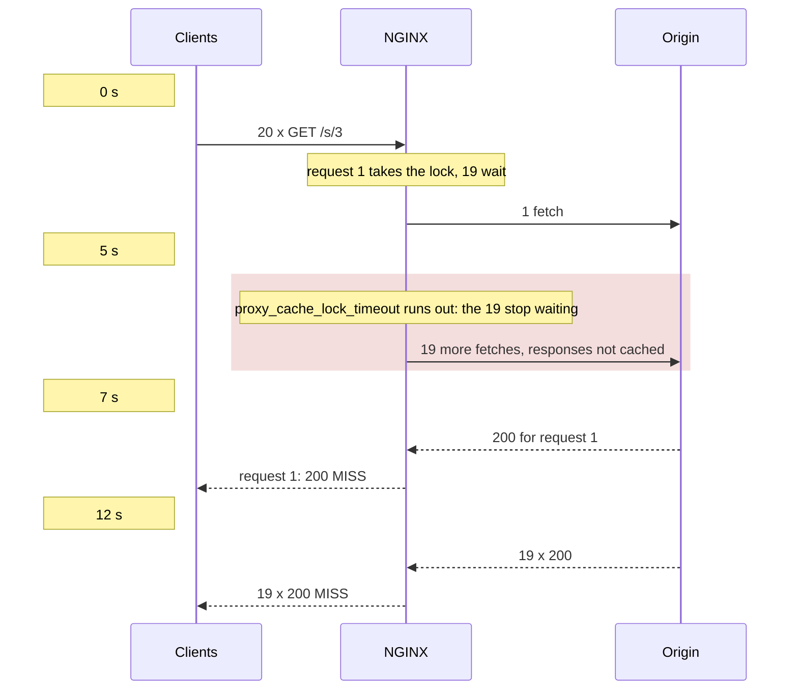

**Origin:** 20 requests: the lock protected nothing. **Waits:** 1 for 7 s, 19 for 12 s. **Log:** 20 `MISS`.

Raise both timers above the slowest normal response. Raising only `proxy_cache_lock_timeout` to 10 s still sends one more request to the origin at 5 s (`proxy_cache_lock_age`): 2 origin requests. With both at 10 s: 1 request, 7 s.

### 4. Expired Entry, Lock Only

```nginx
proxy_cache_lock on;   # no proxy_cache_use_stale
```
The URL was cached a minute ago and has just expired. 20 clients, a 2-second origin.

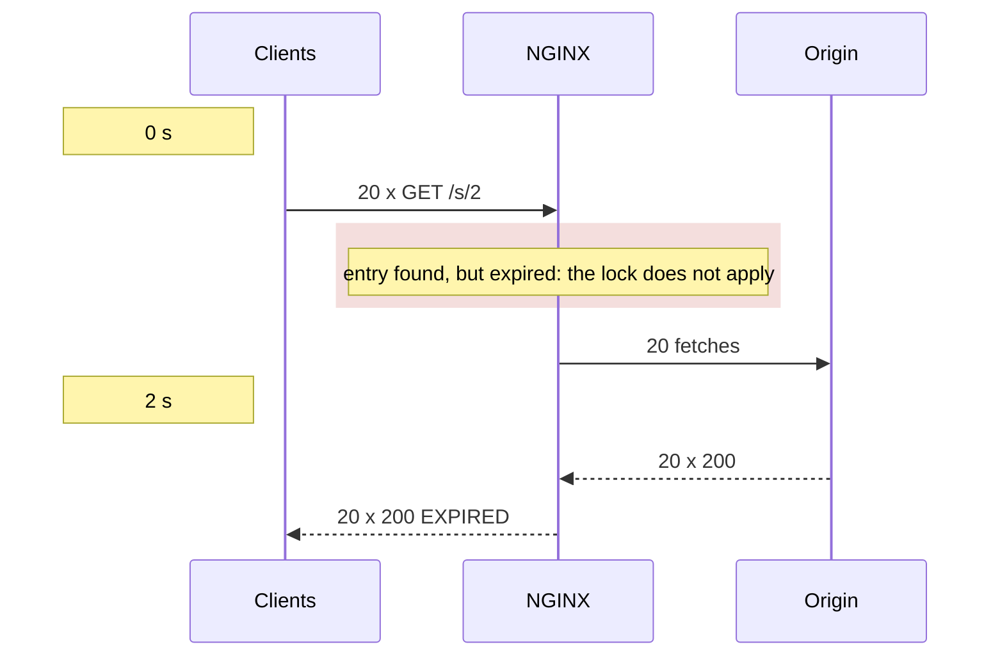

**Origin:** 20 requests, every expiry. **Waits:** all 20. **Log:** 20 `EXPIRED`.

This is the herd that comes back at every expiry of a popular URL, even with the lock on. Your first Activity 3.2 rerun was this case.

### 5. Stale While One Request Refreshes

```nginx
proxy_cache_use_stale updating;
```
Same expired entry, 20 clients, a 2-second origin.

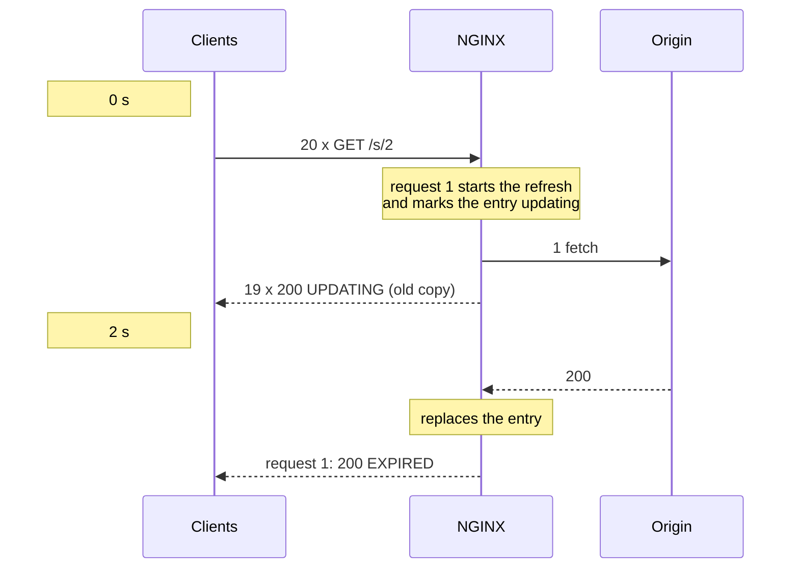

**Origin:** 1 request. **Waits:** only the request that found it expired. **Log:** 1 `EXPIRED`, 19 `UPDATING`.

### 6. Nobody Waits

```nginx
proxy_cache_use_stale updating;
proxy_cache_background_update on;
```
Same expired entry, 20 clients, a 2-second origin.

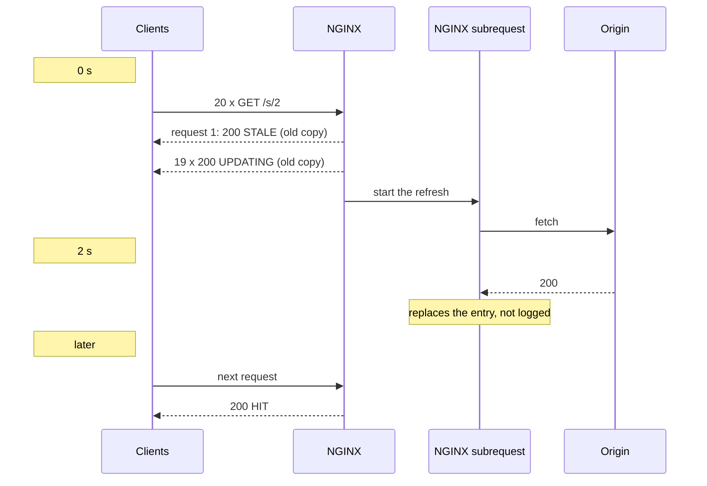

**Origin:** 1 request, in the background. **Waits:** nobody, while a stale copy exists. **Log:** 1 `STALE`, 19 `UPDATING`.

Background update does nothing without `updating` in `proxy_cache_use_stale`.

### 7. Revalidation

```nginx
proxy_cache_revalidate on;   # with background update
```
An expired entry whose object hasn't changed. One client.

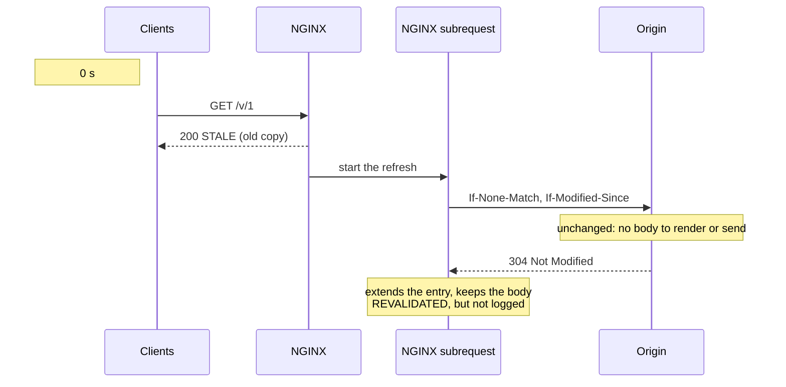

**Origin:** 1 conditional request, 304 with no body. **Waits:** nobody. **Log:** `STALE` (`REVALIDATED` shows only with `log_subrequest on`).

Without background update, the client's own request makes the conditional request, waits for the 304, and is logged `REVALIDATED`.

### 8. Origin Fails, Condition Not Listed

```nginx
proxy_cache_use_stale error timeout;   # no http_503
```
An expired entry, and the origin answers every request with a 503.

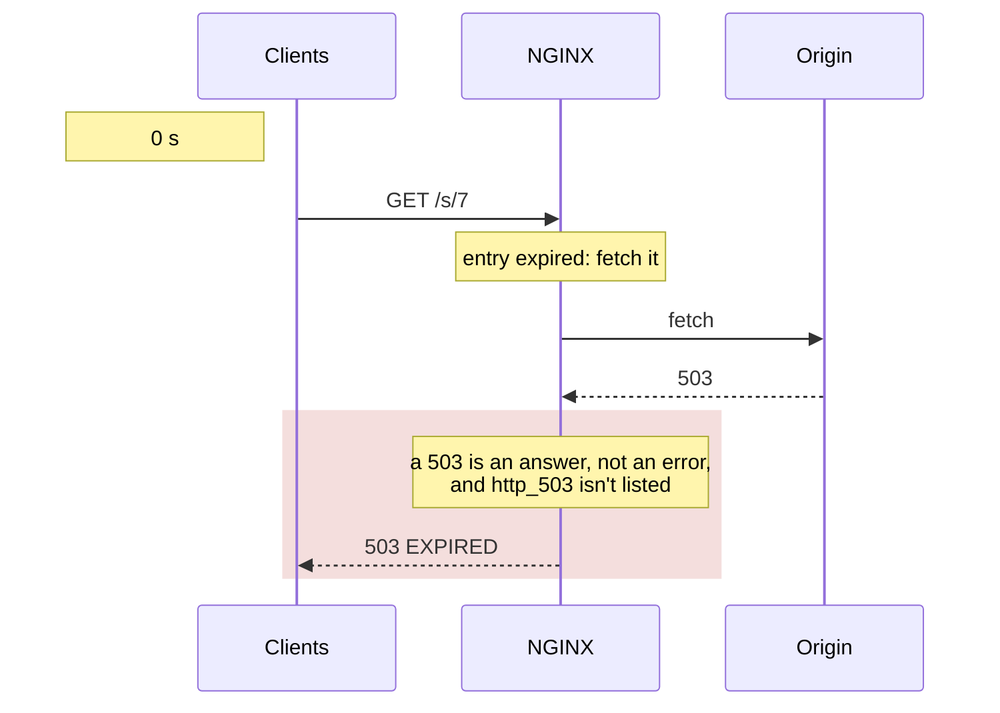

**Origin:** 1 request. **Waits:** the client, and then it gets the error. **Log:** `EXPIRED` with status 503.

### 9. Origin Fails, Condition Listed

```nginx
proxy_cache_use_stale error timeout http_500 http_502
                      http_503 http_504 updating;
```
Same expired entry and the same failing origin.

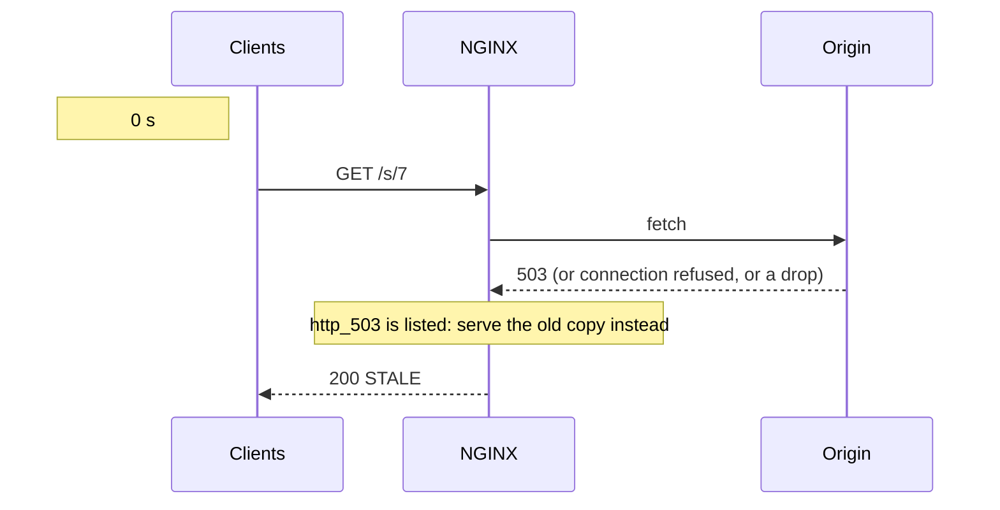

**Origin:** 1 request, failing. **Waits:** the client, for as long as the origin takes to fail. **Log:** `STALE` with status 200.

The client sees a normal 200, so status-code monitoring misses the outage. A URL that was never cached still gets the error: there is no copy to serve. With `timeout`, a hung origin holds the client for `proxy_read_timeout` (60 s by default) before the stale copy, unless background update already answered it.
