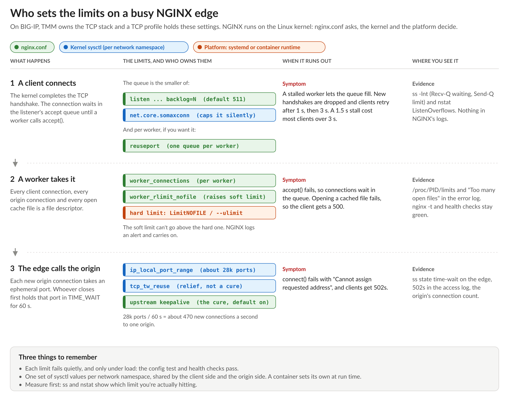

# NGINX Learning Journey, Sprint 4 Day 3: The Limits Below nginx.conf

Days 1 and 2 made the Lumina edge cache correct, then kept it standing on a bad day. Day 3 went one layer down. On BIG-IP, TMM owns the TCP stack and I tune it with TCP profiles. NGINX has no TCP stack of its own. It runs on the Linux kernel, the same way it relies on OpenSSL for TLS (Sprint 3). Some of the limits that decide whether a busy edge keeps up aren't in `nginx.conf` at all.

## Three limits, three owners

A connection runs into three limits on its way through the edge, and each one has a different owner:

- **The accept queue.** The kernel finishes the handshake and parks the connection until a worker accepts it. NGINX asks for a queue length with `backlog=`, and the kernel quietly caps it at `net.core.somaxconn`. When a worker stalls and the queue fills, new handshakes are dropped, and clients wait for their SYN retry. In the lab, a 1.5-second stall cost most clients more than 3 seconds. `reuseport` gives each worker its own queue, so one stalled worker only holds up its share.
- **File descriptors.** Every client connection, origin connection and open cache file is one. `worker_connections` is NGINX's cap, `worker_rlimit_nofile` raises the operating system's soft limit, and the platform's hard limit (systemd or the container runtime) is the ceiling over both. Run out and a request for a perfectly good cached page comes back as a 500.
- **Ephemeral ports.** An edge that opens a new origin connection for every request can only make about 470 a second to one origin before TIME_WAIT has eaten every port, and clients get 502s. `tcp_tw_reuse` buys a little. Upstream keepalive, on by default since nginx 1.29.7, is the real fix.

## They all fail quietly

This was the theme of the day. None of these limits shows up in `nginx -t`, and a health check passes right through them:

- `somaxconn` capping my `backlog=4096` to 128 left no trace in the error log.
- A container whose hard limit was too low turned `worker_rlimit_nofile` into an alert line while everything stayed green.
- An accept queue overflow isn't logged by NGINX at all. Only the kernel's counters show it.

The evidence lives in `ss`, `nstat` and `/proc`. Coming from BIG-IP, where TMM's own statistics show every queue and drop, that's a new set of places to look.

And in containers, kernel settings belong to the network namespace. The host's `sysctl.conf` doesn't reach inside, so `somaxconn` and the port range are part of how the container is run, not how the host is built.

## Is there a Linux tuned for NGINX?

That was my question going in. There isn't an NGINX-specific distro. The kernel version matters more than the distro: it decides which features you have (BBR congestion control, `reuseport` balancing, kernel TLS). Profiles like RHEL's `tuned` network ones and well-known tuning lists exist, but the advice that holds up everywhere is to measure first, and change the limit you can see you're hitting. Modern defaults are good.

That also showed me a gap in my plan. The observability sprint (Sprint 11) only looked at NGINX's own metrics. Every counter from today lives in the kernel. So the plan now puts host metrics on the same dashboard as NGINX's, so the next queue overflow lines up with the latency spike it causes.

## Day 1 came back

My first run of the stalled-worker test looked wrong. It took a minute to see why: my warm-up request and the load test sent different `Host` headers, so they hit different cache keys. **The cache key must include everything the origin uses to build the response,** and it came back to bite me two days later.

## Putting the sprint together

The sprint lab put all three days on the Lumina edge:

- a cache with a correct key, safe handling of authenticated requests, and lifetimes the origin can shorten;
- a lock against thundering herds, stale serving through origin failures, and refreshes that nobody waits for;
- the capacity settings underneath: queue length, file limits, and connections to the origin that get reused.

I needed all three days' notes to get the final config right, and all 10 tests passed.

Sprint 4 in one line: Day 1 decides **what** the cache stores, Day 2 decides **who waits** when it can't answer, and Day 3 decides whether the box underneath has **room to take the connection** at all.

Quiz: 9 out of 10 on the first attempt. Next up: the NGINX Plus side quest, with purging on demand and cache metrics, then Sprint 5: rate limiting.

#NGINX #F5 #Linux #TCP #WebPerformance #LearningInPublic #DevOps
