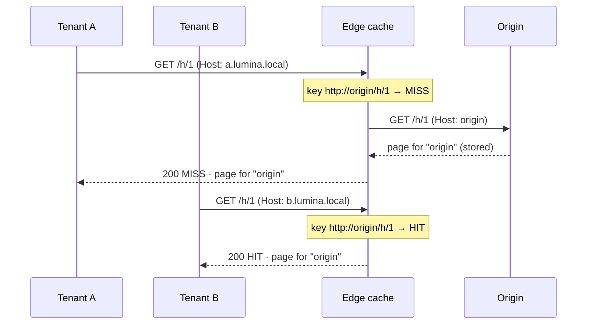
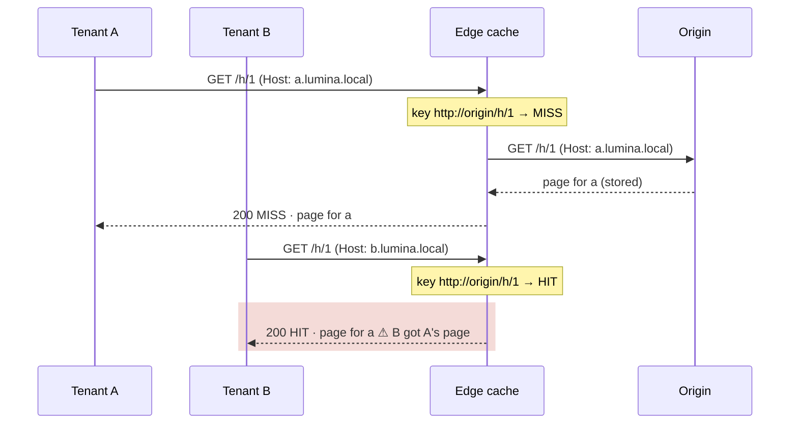
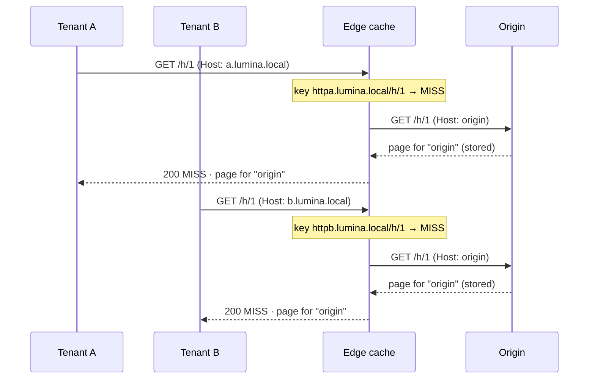
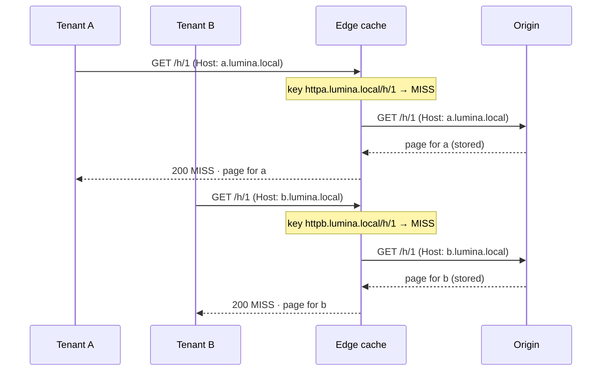

# Host and the Cache Key: Why Fixing One Is Worse Than Fixing Neither

When NGINX sits in front of a multi-tenant origin and caches its responses, it makes two separate decisions about the client's host name:

1. **What `Host` does the origin see?** By default, NGINX sends the name from `proxy_pass` (`$proxy_host`), not the name the client asked for.
2. **Is the host part of the cache key?** The default key is `$scheme$proxy_host$request_uri`, which has the `proxy_pass` name in it, not the client's host.

Each choice has a default and a fix, which gives four combinations. Only one is correct, and the most dangerous one is the one an experienced proxy engineer reaches for first.

## The Setup

Two tenants, `a.lumina.local` and `b.lumina.local`, share one NGINX edge and one origin. The origin builds a different page for each host name it receives. In every scenario below, tenant A asks for `/h/1` first, then tenant B asks for the same path.

## The Four Combinations

| | Key without host (default) | Key with `$host` |
| :--- | :--- | :--- |
| **Origin sees `Host: origin`** (default) | **1. Neither fixed:** wrong, but visible | **3. Key only:** safe, wasteful |
| **Origin sees `Host: $host`** | **2. Host only:** cross-tenant leak | **4. Both fixed:** correct |

### 1. Neither Fixed: Wrong, but Visible



The cache and the origin agree: neither one looks at the client's host. The origin can't tell the tenants apart, so it builds one generic page, and the cache stores that one page under one key. B gets exactly what the origin would have sent B anyway.

Multi-tenancy is broken, but every tenant sees the same wrong page every time. You notice on the first test.

### 2. Host Fixed, Key Not: Cross-Tenant Leak



Now the origin uses the host, but the key still doesn't. The origin correctly builds A's page. The cache files it under a key with no host in it, so B's request matches that entry and B gets A's page.

This is worse than case 1 because it hides:

* Every response is a `200`, and the origin is behaving correctly.
* Which tenant leaks depends on who asked first after the entry expired.
* Test each host on its own against an empty cache, and it looks right.

### 3. Key Fixed, Host Not: Safe, Wasteful



The key is stricter than the origin needs. Each tenant gets its own entry, but both entries hold the same generic page, and the origin is asked once per tenant. Nothing leaks. You pay in extra misses and disk space, and the tenants still don't get their own pages.

### 4. Both Fixed: Correct



The origin builds per-host pages, and the key keeps them apart. A's next request is a `HIT` on A's entry, and B's is a `HIT` on B's. The two lines that get you here:

```nginx
proxy_set_header Host $host;
proxy_cache_key  $scheme$host$request_uri;
```

Two details from the lab:

* **The stored key has no separators.** It really reads `httpa.lumina.local/h/1`.
* **`$host` is lowercased and has no port.** `A.Lumina.Local` hits `a.lumina.local`'s entry, as it should.

## The Rule Behind All Four

**The cache key must include everything the origin uses to build the response.**

| The mismatch | What happens | Severity |
| :--- | :--- | :--- |
| The origin uses something the key leaves out (case 2) | Requests the origin would answer differently share one entry, so a client gets someone else's response | Correctness bug, often a data leak |
| The key includes something the origin ignores (case 3) | Requests with identical answers are stored separately | Lower hit ratio, more disk, more origin load, but every answer is right |

When the two get out of step, the first kind of mismatch leaks and the second only costs. The same rule comes back with `Authorization`: by default the origin uses it, but the key ignores it, so one user's response can be served to the next.

## The BIG-IP Lens

BIG-IP passes the client's `Host` header through to the pool member unchanged. NGINX rewrites it to the `proxy_pass` name unless you tell it otherwise. So a BIG-IP engineer's first instinct on NGINX is to add `proxy_set_header Host $host`. That's the right fix for a plain reverse proxy. On a caching location, though, doing only that puts you in case 2.

**Change the Host and the key together.**
