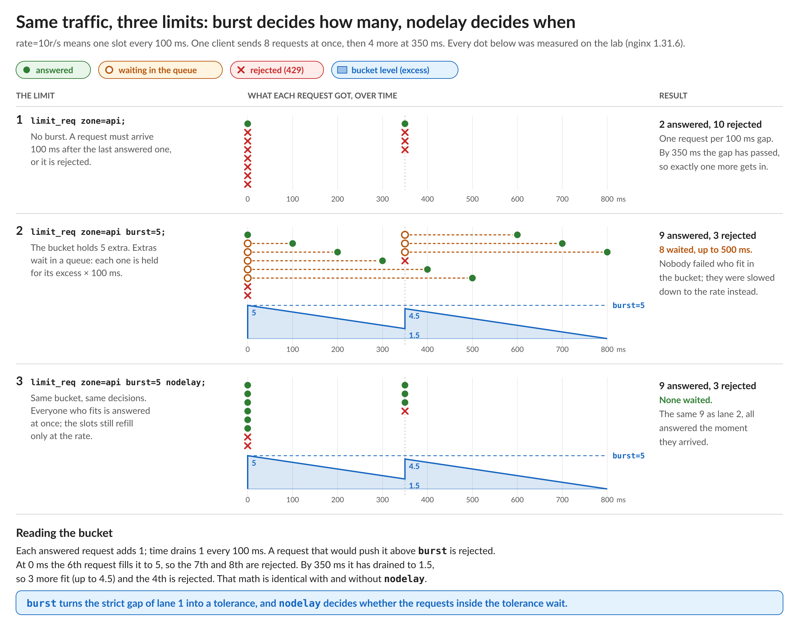

# NGINX Learning Journey, Sprint 5 Day 1: Rate Limiting and the Leaky Bucket

Sprint 5 puts a gateway in front of a new API and starts controlling who gets to use it, and how fast. Day 1 was `limit_req`, NGINX's built-in request rate limit. The config is one line, and I was surprised by how much behavior is packed into it. My quiz score says the timing took me a while.

## The rate is a gap, not an average

`rate=10r/s` doesn't mean "ten requests in any given second". It means one request every 100 ms per client, measured in milliseconds. With no burst, a request that arrives sooner than that after the last accepted one is rejected, whatever the average looks like. A client running only 20% over the rate loses about half its requests, because every other one lands 83 ms after its predecessor.

## Burst and `nodelay`: how many, and when

`burst` gives each client a bucket. Every accepted request adds one, time drains one per gap, and a request that would overflow the bucket is rejected. `nodelay` doesn't change any of that math. It only decides whether the requests inside the bucket are answered right away or held in a queue and released one per gap.

The diagram shows the same twelve requests against three versions of the limit, measured on the lab. With `burst=5` and with `burst=5 nodelay`, exactly the same nine requests get through; the only difference is that eight of them waited, up to half a second, without `nodelay`. The one-line version I'm keeping:

> `burst` turns the strict gap of a no-burst limit into a tolerance, and `nodelay` decides whether the requests inside the tolerance wait.

For APIs, `nodelay` is the usual choice: a page loading its assets shouldn't pay latency for being bursty. The plain queue suits clients you'd rather slow down than refuse, and `delay=` sits in between.

## The details that bite

- **A full zone forgets, it doesn't fail.** Each client's state takes about 64 bytes. When the zone is full, NGINX evicts the least recently used clients, and an evicted client starts over with a clean history. A zone that's too small quietly lets the abusers back in.
- **An empty key is never limited.** Key a limit on an API-key header, and clients that don't send one aren't counted at all.
- **Inheritance drops limits.** A `location` with its own `limit_req` stops inheriting every `limit_req` from above, the same rule as `add_header`. Adding a stricter limit to one path can remove the general one from it.
- **`return` is never rate limited.** `limit_req` runs after the rewrite phase, so a location that answers with `return` has already responded.
- **`limit_req_dry_run`** logs what would have been rejected without rejecting it. Measure first, then enforce.

## Be explicit, especially about defaults

Rejections are `503` by default, which tells clients and monitoring that the service is down. `429 Too Many Requests` didn't exist when `limit_req` was written in 2008. When the status became configurable, the default stayed `503` so upgrades wouldn't change behavior. NGINX doesn't send `Retry-After` either; you add it yourself.

Coming from BIG-IP, the rule I already preach applies here too: don't rely on defaults. BIG-IP defaults change between versions, which is why we build custom profiles with explicit values, and NGINX defaults change too (the default TLS versions did in 1.23.4). On NGINX it matters even more, because there's no parent profile to look at: the default exists only in the binary. So `limit_req_status 429` is part of every limit I write.

One naming thing that confused me at first: `burst` and `nodelay` don't follow the `limit_req_*` naming because they aren't directives. They're parameters on the `limit_req` line, so they're already scoped to it. The split between `limit_req_zone` (define once) and `limit_req` (attach where needed) works like a BIG-IP profile and the virtual servers that use it.

## Lab notes

- The Sprint 5 lab adds a client container that can send from any address on the lab network, so every test is a real client with its own source address and its own bucket.
- Every number in the diagram came from the lab.

Quiz: 6/10 on the first attempt and 9/10 on the second. All four misses were the same thing: when a queued request is answered, and when the bucket has room again. Hence the diagram. Next up, Day 2: concurrent connections, bandwidth and slow clients.

#NGINX #F5 #RateLimiting #APISecurity #LearningInPublic #DevOps
