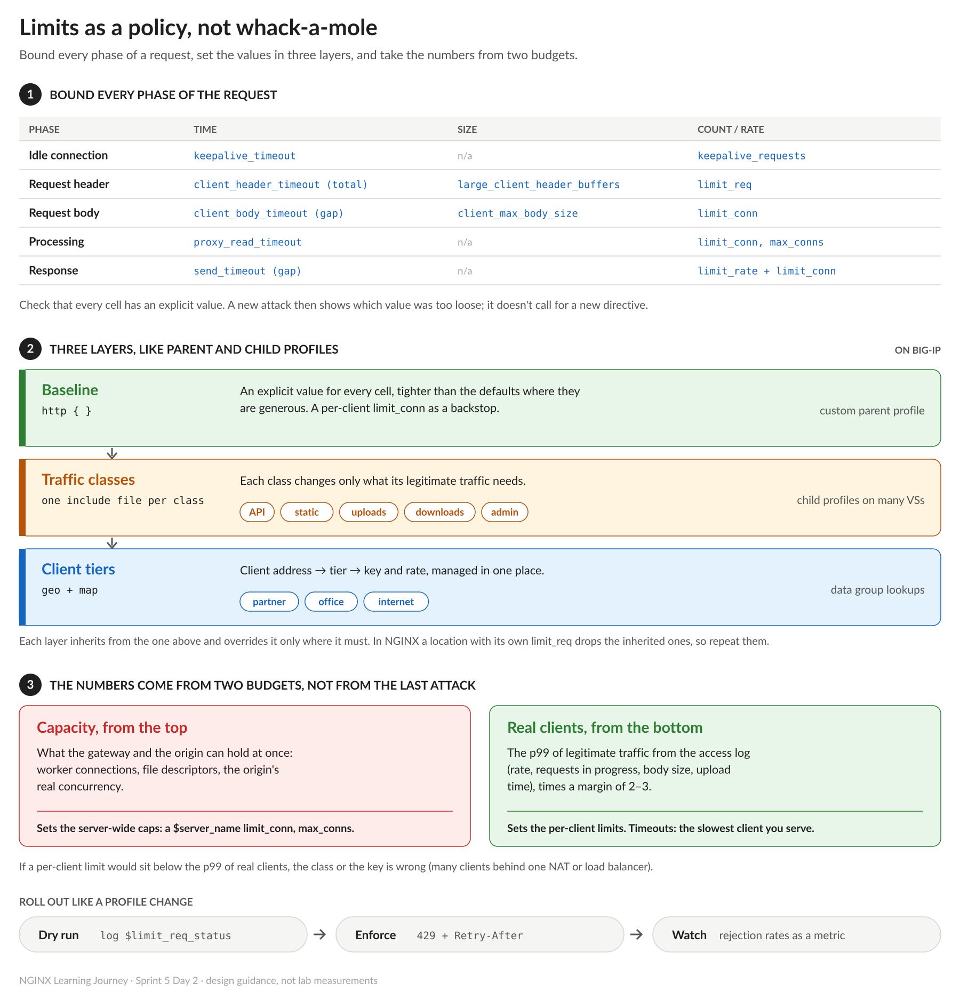

# NGINX Learning Journey, Sprint 5 Day 2: Concurrency, Bandwidth and Slow Clients

Day 1 limited how often a client may ask. Day 2 limited how much it may hold at once: requests in progress, bytes per second, and the time it may take to send a request. None of the directives was hard on its own. The hard part is that there are many of them, and almost every one counts something slightly different from what its name suggests.

## `limit_conn` doesn't count connections

`limit_conn` counts **requests in progress**. A connection counts only once NGINX has read the whole request header, and it stops counting when the response is finished. Two consequences surprised me:

- **HTTP/2 counts every stream.** Five requests multiplexed on one TCP connection, with `limit_conn 2`: two answered, three rejected.
- **A slowloris client isn't counted at all.** It never finishes its header, so as far as `limit_conn` is concerned it doesn't exist yet.

A slow upload is the opposite. Its header is complete, so it holds a slot for as long as the body dribbles in. One client with `limit_conn 1` and a slow upload in progress got its next request rejected.

## Bandwidth is per request

`limit_rate` caps how fast NGINX sends **one response**. Four parallel downloads from one client each got the full rate, so four times the bandwidth. Paired with `limit_conn 1` on the same location, three of the four were rejected and the limit became per client. `limit_rate_after` lets the first part of a response go at full speed, so small files aren't slowed at all.

Coming from BIG-IP: a rate class is one shared pipe for every flow in it. `limit_rate` is a per-response cap, and `limit_conn` is what keeps a client from multiplying it.

## Two timeouts that look alike and aren't

- **`client_header_timeout` is a total.** A header line every 2 s, with a 5 s timeout: the connection was closed at 5.0 s. NGINX logs a `408` but sends nothing back.
- **`client_body_timeout` is the gap between two reads.** One byte every 2 s against a 3 s timeout kept an upload alive indefinitely.

So the header timeout stops slowloris, and slow uploads need `limit_conn` on top of the body timeout. The defaults (60 s for the whole header) are generous.

One BIG-IP reflex I had to adjust: these feel like TCP profile settings, but NGINX doesn't own the TCP stack, the kernel does. What NGINX owns is the timers. Each time it waits on a socket it starts one, and if it fires first, NGINX closes the connection. The kernel doesn't know what an HTTP header is, so "the whole header within 5 seconds" can only be NGINX's rule.

## From whack-a-mole to a policy

The usual way to learn this is "which directive stops which attack". That's how I took notes too, and it leads to whack-a-mole. A design that lasts starts from the request instead:

1. **Every phase of a request has a time, a size and a count**, and each should have an explicit bound before anyone abuses it. A new attack then shows which value was too loose. It doesn't call for a new directive.
2. **Set the values in layers.** A baseline for everything, then one profile per traffic class (API, uploads, downloads, admin), then per-client tiers. That's the parent and child profile model from BIG-IP, built from `include` files and `map`.
3. **Take the numbers from two budgets, not from the last incident.** Capacity from the top: what the gateway and the origin can really hold sets the server-wide caps. Real clients from the bottom: the p99 of legitimate traffic, with a margin, sets the per-client limits. Timeouts are set by the slowest client you want to serve, not the fastest attack.

Roll it out the way you'd roll out a profile change: dry run first, then enforce, then watch the rejection rate.

## One small trap

Adding `Retry-After` to every refusal means checking both `$limit_req_status` and `$limit_conn_status`, so the map uses the two variables joined into one string and a regex, `~REJECTED`. That also matches `REJECTED_DRY_RUN`: in dry run, normal `200` answers carried `Retry-After: 1`. Anchoring the pattern (`~REJECTED$`) fixes it.

## Lab notes

- Every client in the lab sends from its own address, so per-client limits are tested with real clients, including over HTTP/2 and with hand-paced slow senders.
- The numbers above were measured in the lab. The infographic is design guidance.

Quiz: 10/10 on the first attempt. Next up, Day 3: access control, client tiers and finding the real client address behind a load balancer.

#NGINX #F5 #RateLimiting #APISecurity #LearningInPublic #DevOps
