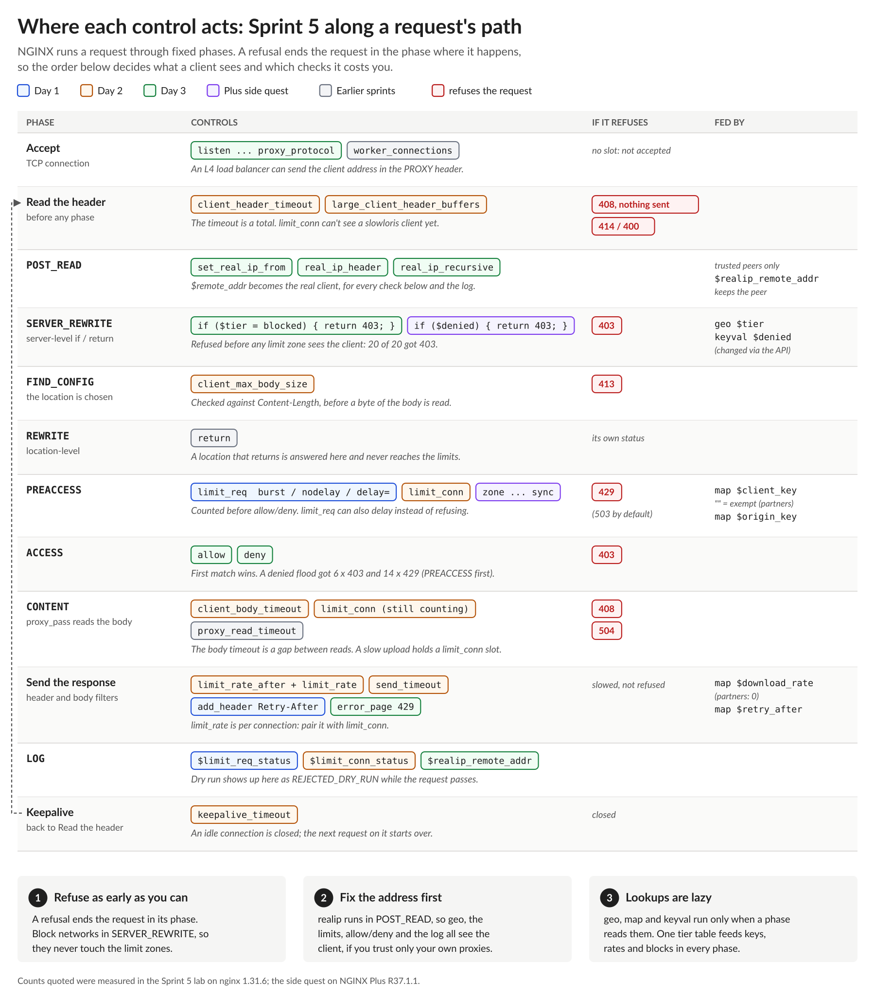

# NGINX Learning Journey, Sprint 5 Day 3: Who Gets In, and Where NGINX Decides

Days 1 and 2 treated every client the same: so many requests per second, so many in progress, so many bytes per second. Real gateways don't work like that. Partners get more, operations staff get the admin pages, an abusive network gets nothing, and the "client" is often a load balancer standing in front of thousands of users. Day 3 built that, and then put the whole sprint together in one gateway.

## The order of the checks is the policy

The lesson that tied the sprint together came from a simple test. I blocked an abusive network with `deny` on the API, then flooded it from that network. I expected a wall of `403`s. I got 21 `403`s and 9 `429`s.

NGINX runs every request through fixed phases, and the limits run before the access rules. Each request from the blocked network was first counted by the rate limit. The ones inside the burst went on to be denied. The rest were told "slow down, retry in a second" by the rate limiter, which is the wrong message for a client you've banned, and they used up state in the limit zones along the way.

The fix is to refuse earlier. A server-level `return 403`, driven by a `geo` lookup, runs in the rewrite phase, before any limit sees the request: 30 out of 30 refused, on every path, not just the API.

That made me want to see the whole sprint laid out by phase:

Three things stand out from that picture:

1. **Refuse as early as you can.** A refusal ends the request in the phase where it happens. The earlier it happens, the less it costs and the clearer the answer the client gets.
2. **Fix the address first.** Everything below depends on knowing who the client is.
3. **Lookups are lazy.** `geo`, `map` and the NGINX Plus key-value store cost nothing until a phase reads them, so one tier table can feed every phase.

## From an address to a policy

On BIG-IP I'd reach for address data groups and an iRule. NGINX does it in configuration, with no code:

- **`geo`** turns the client address into a name: `partner`, `ops`, `blocked`, `internet`. The most specific network wins.
- **`map`** turns that name into a value for each control: the key a rate limit counts by, the speed for downloads, whether to block.

The trick I liked most: **an empty key is never limited.** Map the partner tier to an empty string and that one line exempts partners from every limit keyed on it. Map their download rate to `0` and they download at full speed. One table, one place to change.

## Finding the real client

Behind a load balancer, every connection comes from the load balancer. Without help, every user lands in one rate-limit bucket, and the tier lookup sees one address.

The realip module fixes that in the very first phase: it replaces the client address with the one in `X-Forwarded-For`, but **only for connections from addresses you trust.** Everything after it, the tiers, the limits, the access rules and the logs, sees the real client. A client that sends its own `X-Forwarded-For` directly is ignored, so it can't claim to be a partner.

This is the receiving end of BIG-IP's "Insert X-Forwarded-For". The same caution applies: trust the header only from hops you control.

## Putting the sprint together

The sprint lab was the Lumina API gateway, with 13 requirements: rate and concurrency limits on the API, protection for the origin, an upload size limit, a strict login limit, throttled downloads, partner exemptions, an operations-only admin area, the blocked network, the load balancer and slow clients.

None of the pieces is hard on its own. This was the most challenging lab so far, because it needs all three days at once, and because the mistakes don't show. A server-wide cap keyed on a server name that was never set counts nothing. Two locations sharing one concurrency zone limit each other. Changing a limit zone's key is refused on reload while the old configuration keeps running, and only the error log says so. Each of these passes the syntax check. I got all 13 tests passing, then mapped every requirement to the lines that meet it and the test that checks it, which is where the understanding really landed.

## Sprint 5 in one line

Day 1 decides **how often** a client may ask, Day 2 **how much it may hold**, and Day 3 **who the client is and whether it gets in**. Across all three, the same two rules kept coming back:

- **The key is the policy.** Every limit is "per key", and the key decides who shares a bucket: one client, everyone, nobody, or everyone behind a load balancer.
- **The phase decides the answer.** Which directive you use is half the design. Where NGINX runs it is the other half.

Coming from BIG-IP, the mapping is close: DoS profiles and iRule tables become `limit_req`, connection limits become `limit_conn`, rate classes become `limit_rate`, data groups become `geo` and `map`. The difference is that it's all declarative configuration, evaluated in a fixed order, and that order is worth learning by heart.

Quiz: 8 out of 10. Both misses were about the tier-based limit key: an exemption only reaches the zones keyed on it, and a zone's key can't be changed by a reload.

## What's next

I'm doing the NGINX Plus side quests for Sprint 4 and Sprint 5 together, early next week, ahead of Sprint 6:

- **Sprint 4:** purging the cache on demand and live cache metrics.
- **Sprint 5:** a denylist that changes through the API without a reload (BIG-IP's AFM and IP intelligence, updated over iControl, is the comparison), and rate limits shared across a two-node cluster.

Then Sprint 6: programmability and extensibility.

#NGINX #F5 #APISecurity #RateLimiting #AccessControl #LearningInPublic #DevOps
