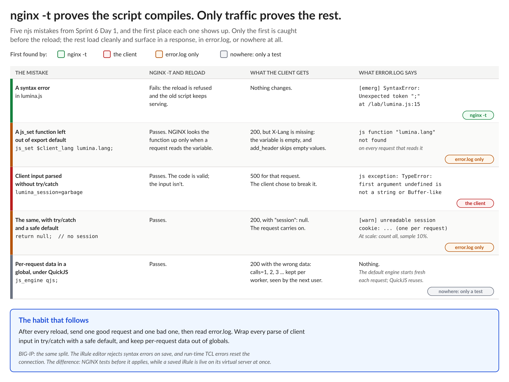

# NGINX Learning Journey, Sprint 6 Day 1: JavaScript Inside NGINX

Sprint 6 is programmability. For five sprints, everything NGINX did came from configuration. Now there's code: njs, a JavaScript runtime built into NGINX. Coming from iRules, I expected a familiar tool in a new language. What I found was a different model for where logic lives, and a few traps that look a lot like the ones I already know.

## The config is the program, and the script is a library

An iRule runs inside the virtual server's own processing. Events fire by name, and commands like `pool` and `HTTP::header insert` steer the traffic directly. njs works the other way round. A JavaScript function runs only when a directive calls it:
- `js_content` answers a request.
- `js_set` computes a variable.
- Filters change a response.
- `js_preread` inspects a TCP connection.

So there's wiring: write the function, export it, name it in a directive, then use the variable somewhere.

That felt like more places to get wrong, and on Day 1 I proved it. I wrote a function, wired it into the config, reloaded, and nothing happened. I'd left the function out of the script's export list. The good news is that the wiring also documents itself: `grep js_` lists every place a script touches traffic, and a location with no `js_` directive is guaranteed to be untouched.

## `nginx -t` proves the script compiles. Only traffic proves the rest.

This is the insight I'll keep from Day 1:

`nginx -t` compiles the script, so a syntax error is refused before the reload, and the old script keeps serving. That's better than saving an iRule and finding out live. Everything else on the chart loads cleanly:

- **A missing export:** the request returned 200, the variable was quietly empty, and the header that used it was missing. The only sign was a line in `error.log`.
- **Client input parsed without `try`/`catch`:** a garbage cookie turned into a 500. The client chose to break my edge.
- **The same code with `try`/`catch` and a safe default:** a 200 and a warning in the log. At scale that becomes a flood, so count every bad input in a shared counter and log a 10% sample for pattern hunting.
- **Per-request data in a global:** with the QuickJS engine, it silently leaks into the next request on that worker. Nothing shows up anywhere.

None of this is new to anyone who has debugged a TCL error in `/var/log/ltm`. What's different is the habit: after every reload, send one good request and one bad one, and read the error log.

## Two engines, two lifetimes

njs 1.0 ships two JavaScript engines, chosen per location:
- **The njs engine** (the default) gives every request a fresh context. A global counter read 1, 1, 1, 1: a "global" there really lasts one request.
- **QuickJS** (`js_engine qjs`) reuses contexts. The counter read 1, 2, 3, and each worker had its own count.

That's the same lesson as changing a `static::` variable at run time on BIG-IP: every TMM gets its own copy. For state every worker should see, njs has a shared dictionary, which is Day 2's topic.

## "Why doesn't my ES5 work?"

Some JavaScript that's decades old fails in both engines: undeclared variables, octal literals, `with`, `arguments.callee`, `eval`. That isn't missing ES5. It's ES5's forgiving *sloppy mode*, and both engines run strict mode only. The njs engine was built for NGINX around cheap contexts that are thrown away with each request, and its features were added as configuration scripting needed them. QuickJS brings the modern language (`class`, destructuring, `Map`) for anyone who needs it. And no `eval` means no code runs that `nginx -t` hasn't already seen.

## Native first, code when needed (with my own exception)

The `js_set` activity ended with a twist: the same language lookup can be written as a native `map`, which can't throw, needs no script, and is the better tool. A `js_set` variable is lazy: it costs nothing until something reads it, and then it runs once per request, however many times it's used.

My own rule adds one exception: when *all* of a feature's logic can live in code, I'll keep it there, so I don't have to work out feature by feature which parts belong in config. The cost is real, since every decision in code is one more place for a run-time error. It's the same trade-off as one big iRule versus a mix of profiles, data groups and iRules: one place to read, more code to test.

Quiz: 9 out of 10. The miss was on when a `js_set` function runs: lazily, only when something reads the variable, and once per request.

## What's next

Day 2: verifying signed session cookies with HMAC (and where the key lives), signed download links (native or scripted), rewriting response bodies, and a revocation list shared by every worker and refreshed in the background.

#NGINX #F5 #njs #JavaScript #iRules #EdgeComputing #LearningInPublic #DevOps
