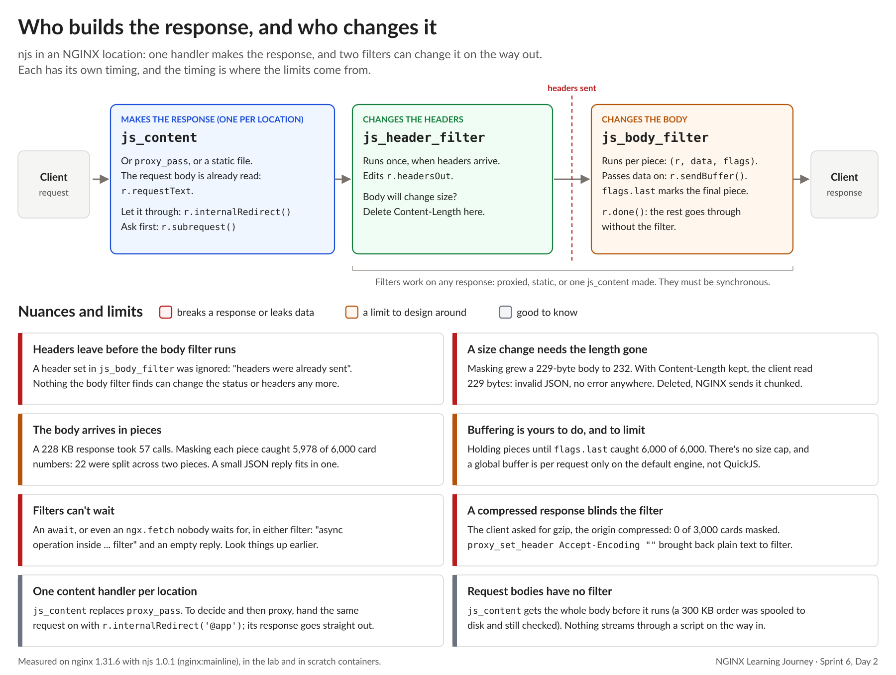

# NGINX Learning Journey, Sprint 6 Day 2: Signatures, Bodies and Shared State

Day 1 put JavaScript inside NGINX. Day 2 gave it real edge work to do: verify signed sessions, sign download links, rewrite response bodies, check request bodies, and share a revocation list across every worker. Each one taught me something about *when* a script runs, and that timing is where most of the limits come from.

## A signature you can verify, and a key that isn't in the config

The session cookie is a signed token. Checking it at the edge takes a few lines of njs: recompute the HMAC-SHA256, compare, then check the expiry and whether the session has been revoked. A correct signature on its own isn't enough.

The more interesting part was the key. It comes from the platform as an environment variable, not from `nginx.conf`. NGINX starts its workers with an empty environment, so the script saw nothing until one `env LUMINA_KEY;` line let that single variable through. Because the code checks for a missing key first, it failed closed (every session refused) instead of crashing with a 500 on every request. That only moves the key from the config to the container, though. On BIG-IP the device owns the secret (an iFile, or the FIPS/NetHSM key store for the serious cases). Here the platform injects it, and NGINX's only job is to let it through. Real secret storage gets its own sprint later.

Once a session is verified, the edge tells the application who the user is with `proxy_set_header X-User`. That **replaces** whatever the client sent, and an empty value means no header at all. But it only applies to the location it's written in. An `HTTP::header replace` in `HTTP_REQUEST` covers the whole virtual server; `proxy_set_header` covers one location. A path served by another location passed a client's own `X-User: admin` straight through to the application. A header the application trusts has to be set, or cleared, everywhere the application can be reached.

## Native when it's enough

NGINX already has signed links: `secure_link` worked with no script at all. The catch is in the configuration: the secret sits in `nginx.conf` in plain text (in git, in backups, in every `nginx -T` dump), and the hash is MD5. For low-value links, native wins. When policy requires SHA-256 and a key kept outside the config, the script does the check and then hands the request to a **named location** (`@files`), which clients can't reach directly. The script decides; configuration does the proxying. It's the `pool` line at the end of an iRule, except the script can't pick the pool itself, so it hands the request to a piece of config that can.

One detail I liked: check the signature *before* the expiry, so a forged link learns nothing, not even that it's expired.

## Who builds the response, and who changes it

This was the core of the day, so it got the infographic:

The model is simple: one handler makes the response (`js_content`, `proxy_pass` or a static file), the header filter runs once, the headers leave, and then the body filter runs **once per piece** as the body streams out. Every limit on the chart follows from that order:

- **The headers are gone before the body filter runs.** Masking card numbers grew a 229-byte response to 232, and the origin's `Content-Length` still said 229. The client read 229 bytes and got invalid JSON, and nothing logged an error. Deleting the length in the header filter fixes it: NGINX switches to chunked encoding by itself.
- **Pieces have edges.** On a 228 KB response, masking each piece caught 5,978 of 6,000 card numbers. The other 22 were split across two pieces. Buffering until the last piece caught them all, but then the memory limit is your job.
- **Filters can't wait.** An `await` in a filter gives the client an empty reply. Lookups belong earlier.
- **Compression blinds a body filter.** When the client asked for gzip, the filter saw compressed bytes and masked 0 of 3,000 cards. The data leaked. Asking the origin for plain text fixed it.

Coming from iRules, this was the biggest shift of the day. `HTTP::collect` is opt-in: the response waits, headers included, until `HTTP::release`, so the iRule can still fix the length after rewriting the payload. njs streams by default: every piece goes out unless the script holds it back, and the headers are already gone either way. It's closer to a Stream profile than to collect. Holding back a piece is the collect, a final `r.sendBuffer()` is the release, and `r.done()` is `STREAM::disable`. Like a Stream profile with Rechunk, NGINX handles the framing once the length is gone, but the script has to remove it.

## Reading a request, then letting it through

For request bodies there's no filter. `js_content` gets the whole body before it runs (a 300 KB order was spooled to disk and still validated). That's the `HTTP::collect` in `HTTP_REQUEST_DATA` dance, done by NGINX before the script starts. After checking it, the script has two ways on:
- `r.internalRedirect('@app')` passes the **same** request (method, headers, body) on, and the application's answer goes straight back to the client.
- `r.subrequest()` makes a **second** request and hands the answer to the script. It's the right tool when the script needs the answer to decide something.

## State every worker can see

A signed session stays valid until it expires, even after a logout. The fix is a revocation list refreshed every 2 seconds. Two pieces make it work:
- `js_periodic` runs the refresh on a timer, with no request involved, and only on worker 0, so the application gets one fetch, not one per worker.
- `js_shared_dict_zone` puts the list in shared memory, where every worker reads it as `ngx.shared.revoked`.

On BIG-IP that's `table` for the store and `after -periodic` or iCall for the timer.

The fetch itself is where the comparison gets interesting. A sideband connection (`connect`/`send`/`recv`) is raw TCP: the iRule writes the HTTP request and parses the reply itself, but it can connect to a virtual server and use its pools, monitors and SSL profiles. `ngx.fetch` is the opposite trade: a real HTTP client (headers, JSON, TLS built in) that connects straight to a host and skips NGINX's upstreams. It even needed its own `resolver` before it could find the origin by name. And when the fetch fails, the script keeps the last list it had. That's fail-open on stale data, and it's a policy decision worth writing down, not a default to inherit.

## Quiz: 8 out of 10

Both misses were details worth fixing in memory:
- **`secure_link`'s three answers:** empty means a bad or missing signature (403), `"0"` means valid but expired (410), and `"1"` means good.
- **How a script reads a shared zone:** `ngx.shared.<zone>`, not an NGINX variable.

## What's next

Day 3: routing on verified session claims instead of a cookie anyone can set, njs at layer 4 (inspecting TCP before choosing a backend), what failure looks like when a script misbehaves, and the sprint lab.

#NGINX #F5 #njs #JavaScript #iRules #EdgeSecurity #LearningInPublic #DevOps
