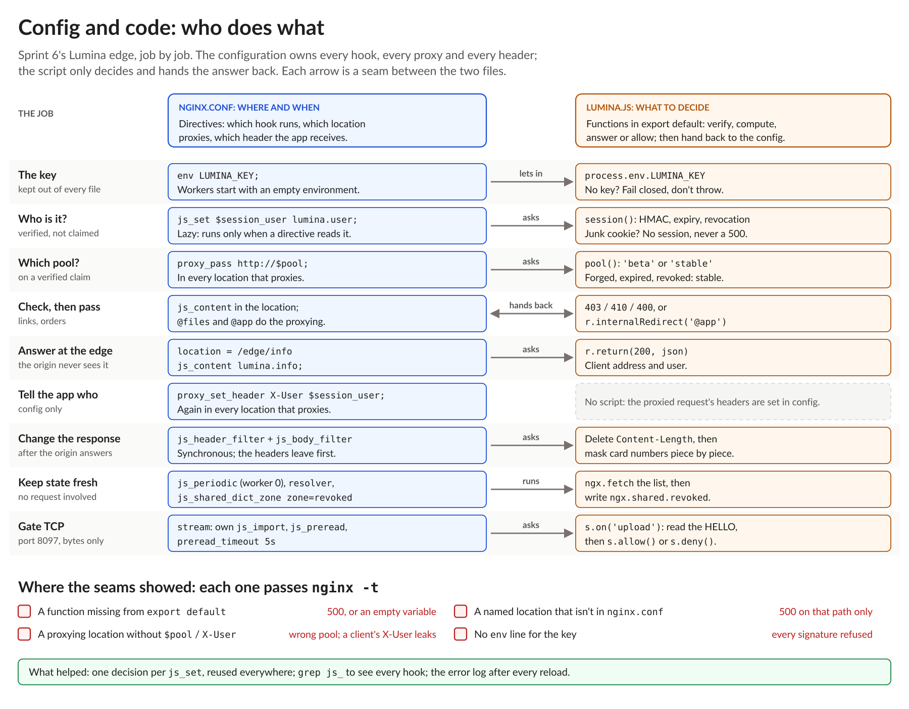

# NGINX Learning Journey, Sprint 6 Day 3: Routing, TCP and the Price of a Script

Day 3 closed out the programmability sprint. The verified session now decides **where** a request goes, not just who it's from. The same JavaScript engine moved down to raw TCP. Then I measured what a slow script costs. And the sprint lab put the whole week together into one edge.

## Routing on a claim you can trust

`proxy_pass http://$pool;` picks an `upstream` by name for each request. The interesting part is **what sets `$pool`**.

A `map` on a plain `lumina_plan=beta` cookie routes anyone who types that cookie into the beta pool. A `map` can't check a signature, so routing on a verified claim needs the script. `js_set $pool` returns `beta` only when the session passes the Day 2 checks: the HMAC is right, the token hasn't expired, and it isn't revoked. Revocation applied to routing for free, because both use the same check. A forged token, an expired one and a revoked one all landed in `stable`.

On BIG-IP this is one line at the end of an iRule: `pool beta`. In NGINX the script returns a name, and **every location that proxies** has to use it. I had a named location, reached by `internalRedirect`, that still said `proxy_pass http://stable`. Beta orders quietly went to the stable pool.

## njs at layer 4

The `stream` module proxies TCP and UDP, and njs works there too. There are no headers or cookies, only the first bytes of a connection. The Lumina telemetry port expects a signed greeting, `HELLO <device> <sig>`. A `js_preread` handler buffers bytes until it has a full line, then calls `s.allow()` or `s.deny()`. A denied connection is closed **before NGINX ever connects to the backend**: the intake never saw it.

It maps almost one to one onto `CLIENT_DATA` with `TCP::collect`, `TCP::payload` and `reject`. Three things were worth learning by heart:
- **The stream block needs its own `js_import`.** It doesn't see the http block's imports.
- **Returning without a decision means "wait for more bytes."** It's not an implicit allow or deny.
- **A client that sends nothing is held for 30 seconds by default** (`preread_timeout`). That's a free connection slot for anyone who opens a socket and goes quiet. Five seconds was plenty for a device that speaks first.

And for the most common L4 case, routing TLS by hostname, no script is needed: `ssl_preread` + `map $ssl_preread_server_name` reads SNI without decrypting.

## What a script really costs

An NGINX worker is a single thread running an event loop. While a script runs, that worker does nothing else.

I added a deliberately bad function that kept the CPU busy for 3 seconds, on a 2-worker edge. With one slow request, other requests didn't notice: the free worker picked up every new connection. With two slow requests, one per worker, **every** request took about 2.7 seconds, for 1 ms of real work.

That led to the best question of the day: how do connections get to a worker? Whichever worker is free accepts the next connection, and the connection stays with that worker for its whole life. A busy worker isn't even competing for new ones. That's different from BIG-IP's CMP, where the disaggregator hashes each connection to a TMM up front. NGINX can work that way too (`listen ... reuseport`), and then a request can land on the stuck worker while the other one sits idle.

The lesson is the one every iRule author already knows, "keep it short, you're on the data path", with sharper teeth. Real versions of that bad function are a regex over a large body, decompressing an upload, a loop over a big list on every request. Keep per-request work small, and move slow or remote work to timers and shared state.

## The sprint lab: Lumina Edge Functions

Ten requirements, all from this week:
- a signing key from the environment, never in a file
- verified sessions passed on as `X-User`
- malformed cookies that never cause an error
- beta routing on the verified plan
- revocation within 5 seconds
- an endpoint the edge answers itself
- signed download links (403 vs 410)
- order validation at the edge
- card-number masking in responses
- a signed-greeting gate on the TCP port

**10 out of 10.** The two that held me up weren't about JavaScript at all. Both were about the wiring between the two files:
- **A function I wrote but didn't export.** `nginx -t` passed and the reload worked, but the endpoint returned 500. It also failed a second test, because that test checked malformed cookies through the same endpoint. The error log said exactly what was wrong: `js function "lumina.info" not found`. This was my second missing export of the sprint.
- **A named location I'd drafted but never put in `nginx.conf`.** My validator was right, and every bad order got its 400. But the script handed good orders to `@app`, which didn't exist, so good orders got 500.

## Config and code: who does what

That pattern is the sprint in one picture:

Every job in the lab had two halves. The configuration owns **where and when**: which hook runs, which location proxies, which header the application receives. The script owns **what to decide**. Every arrow on that chart is a seam between two files. Each seam I got wrong passed `nginx -t`.

## Sprint 6 in one line

Day 1 put JavaScript **inside** NGINX, Day 2 gave it **edge work** (signatures, bodies, shared state), and Day 3 let it **choose the destination**, **guard a TCP port**, and showed **what it costs**.

## My honest take

Coming from iRules, I find the njs model **less intuitive** than BIG-IP. An iRule is one place: an event fires, and the code inspects, decides and steers the traffic itself (`pool`, `HTTP::header`, `reject`). In NGINX, a single feature crosses back and forth between the config and the code. The script can't pick a pool or add a header to the proxied request; it returns a value, and config has to use it, in every location that needs it. For my taste, that's too much crossing of streams.

There's a real argument for the design, and I can see it now:
- **Native first.** `map`, `geo`, `secure_link`, `ssl_preread`, `sub_filter` and the limit zones can't throw and need no code review. The script is only for what native can't do.
- **The hooks are visible.** `grep js_` lists every place code touches traffic. A location with no `js_` directive is guaranteed untouched.
- **NGINX keeps doing the heavy lifting.** Upstream balancing, keepalive, buffering, caching and retries stay in C. The script only makes the decision.

What I'm taking away is less about the syntax and more about **how to approach the problem**:
1. Decide whether native does it.
2. If not, compute each decision **once** (one `js_set`) and reuse it everywhere.
3. Fail closed on bad input.
4. Keep work off the request path.
5. Read the error log after every reload, because `nginx -t` only proves the script compiles.

## Quiz: 7 out of 10, then 9 out of 10

Every miss, in both attempts, was about `js_preread`, so the stream side is my review topic. The points I'm going over:
- what a preread handler receives (a session, `s`, not a request)
- that returning without a decision waits for more bytes
- that `s.deny()` closes the connection before any upstream connection is made
- the stream block's own `js_import`
- the default 30-second `preread_timeout`

## What's next

The **Side Quest Gauntlet**: the NGINX Plus side quests from Sprints 4, 5 and 6 combined into one "Black Friday war room" simulation. Incidents arrive as tickets, with an SLA timer and a scoreboard. They cover cache purge and metrics, a live denylist and cluster-wide limits, and njs with the Plus key-value store, compared with OpenResty/Lua.

Then Sprint 7: security hardening and zero trust, with mTLS, `auth_request` and OAuth2 Proxy.

#NGINX #F5 #njs #JavaScript #iRules #EdgeSecurity #LearningInPublic #DevOps
