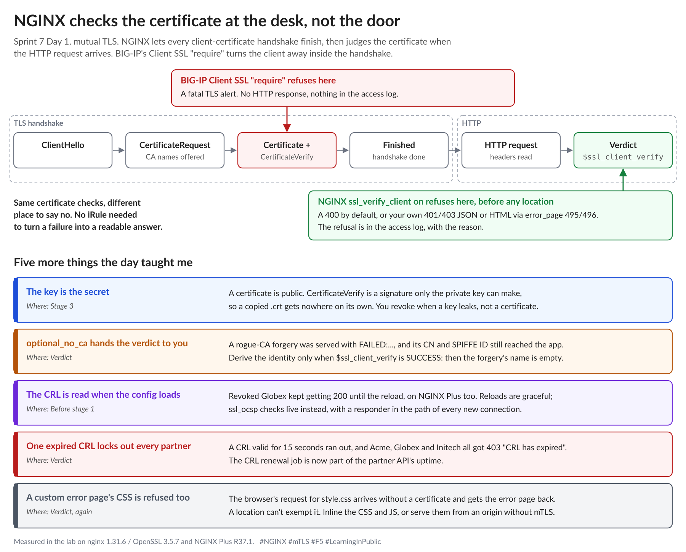

# NGINX Learning Journey, Sprint 7 Day 1: Mutual TLS, Both Ways

Sprint 7 is about identity: who is calling, and how the edge knows. Day 1 was mutual TLS. Partners prove who they are with a client certificate, and the edge proves who it is to a backend. On BIG-IP that's a Client SSL profile set to *require* with a trusted CA bundle, plus a certificate and key in the Server SSL profile. In NGINX it's a handful of directives. The surprise of the day wasn't how to configure it. It was **where NGINX says no**.

## NGINX checks the certificate at the desk, not the door

When BIG-IP's Client SSL profile requires a certificate and the client has none (or a bad one), TMM ends the handshake with a fatal TLS alert. The client gets no HTTP response, and there's no HTTP request to log.

NGINX does the same checks (chain, dates, revocation) at the same moment, through OpenSSL, but it **lets the handshake finish**. It holds on to the result, and when the HTTP request arrives, it refuses it before any location runs. By default that's a `400`. With `error_page 495` / `496`, it's whatever you want: in the lab, a `401` or `403` with a JSON body a partner's code can parse. And the refusal lands in the access log with the reason, such as `FAILED:certificate revoked`.

To get that on BIG-IP, I'd set the profile to *request* and write an iRule: pull the certificate apart, check `SSL::verify_result`, build the response with `HTTP::respond`. In NGINX it's the default behaviour, with no code.

It isn't free, though:
- **No refusal inside the handshake.** An unauthenticated client always completes TLS and gets to send a request before it's turned away (no location or upstream runs). The `stream` module is the stricter option: the handshake still completes, but a missing or failed certificate just closes the connection, with no response at all.
- **A styled error page is harder than it looks.** The browser's request for the page's CSS also arrives without a certificate, so it gets refused too. A location can't exempt it, because the check runs before locations are chosen. Inline everything.

## The certificate is public. The key is the secret.

What stops someone who copied a partner's certificate file? A message I'd never paid attention to: **CertificateVerify**. The client signs the handshake with its private key, and a certificate without its key can't produce that signature. So what leaks, and what gets revoked, is a **key**. (That was one of my two quiz misses.)

## Deciding later means deciding right

`ssl_verify_client` has four modes, and `optional_no_ca` is the interesting one. It lets a certificate from an unknown CA through and hands you the verdict in `$ssl_client_verify`. In the lab, a forged "Acme" certificate signed by a rogue CA came through with `FAILED:...`. Its subject still filled `$ssl_client_s_dn`, and its SPIFFE ID still reached the application. A simple CN `map` happily named the caller `acme`.

The fix is two chained `map`s: read the CN from the certificate, but only use it as the partner's name when `$ssl_client_verify` is `SUCCESS`. Then the forgery's name is empty. The same rule applies to every header the application trusts: the edge must **set** it, never pass the client's version through.

Two smaller identity lessons:
- `$ssl_client_s_dn` is in RFC 2253 order, with the CN **last**.
- NGINX has no variable for the subject alternative names, which is where modern identities live (a SPIFFE ID such as `spiffe://partners.tidewater/acme` is a URI SAN). The way round it is to forward the whole certificate and let the application parse it.

## Revocation has an uptime cost

- **The CRL is read when the configuration loads.** I revoked Globex, and Globex kept getting in until the reload. NGINX Plus behaves the same way: `ssl_crl` takes no variables and the API has no CRL endpoint. Reloads are graceful, so a timer that fetches the CRL, runs `nginx -t` and reloads is the normal pattern. The alternative is `ssl_ocsp`, which asks the CA's responder during the handshake, with no reload. The cost: a responder in the path of every new connection, unless you cache the answers.
- **An expired CRL locks out everyone.** I published a CRL valid for 15 seconds and waited. Acme, Globex and Initech, all from the same CA, all got `403 "CRL has expired"`. Initech's log line no longer even said "revoked". One stale file took every partner offline at once, so the CRL renewal job is now part of the partner API's uptime.

## The edge as a client

The last activity flipped the roles: the finance ledger only accepts clients with a certificate from the internal CA. `proxy_ssl_certificate` gets the edge in. Then someone moved the ledger's address to an impostor, and the edge happily sent it the partner's request. `proxy_ssl_verify` is **off** by default: the connection was encrypted, but nobody checked who was at the other end. With verification on, the next lesson was naming: the name checked is the `upstream` block's name unless `proxy_ssl_name` says otherwise. It's the same discipline as a Server SSL profile with a trusted CA and server name checks, just not on by default.

And one finding from building the lab that's worth knowing: since nginx 1.29.7, upstream keepalive is on by default. A certificate is checked once, at the handshake, so already-verified connections to the real ledger kept being reused after the address moved.

Quiz: 8 out of 10. The misses: what CertificateVerify protects against, and what the two-map chain gives a forged certificate under `optional_no_ca` (an empty name, which is the point of the fix).

## What's next

Day 2: `auth_request`. Instead of deciding from a certificate, the edge asks an authorization service before serving the request, much like an APM policy or an iRule doing an `HTTP::callout`. Its surprises: what the service actually sees, what happens when it fails, and how caching its decisions can hand out the wrong one.

#NGINX #F5 #mTLS #TLS #PKI #ZeroTrust #BIGIP #LearningInPublic #DevOps
