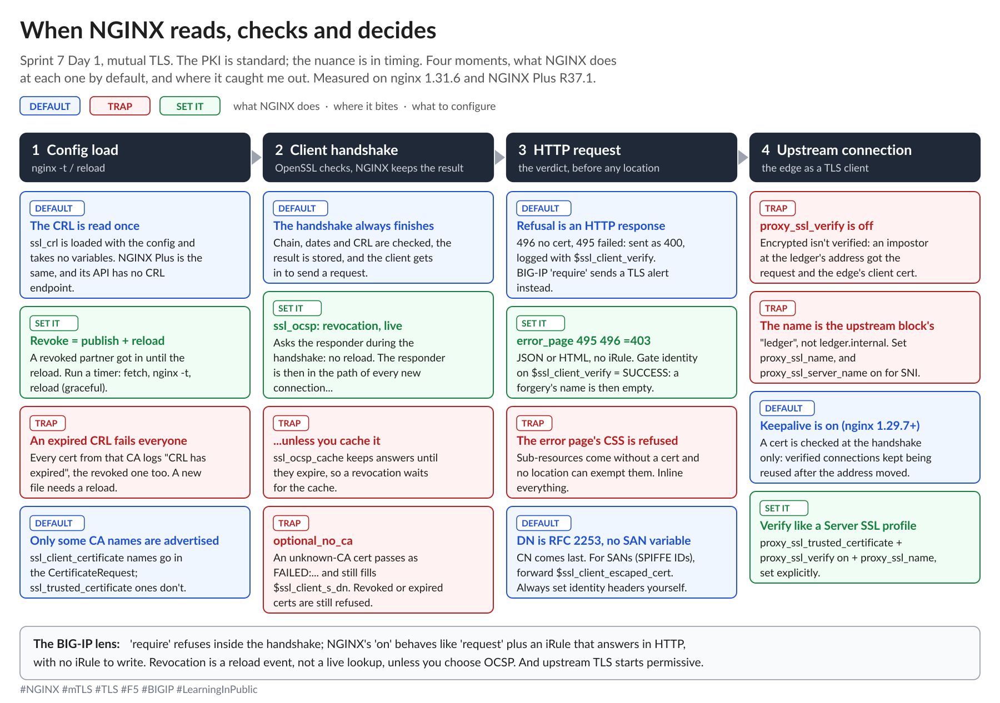

# NGINX Learning Journey, Sprint 7 Day 1: Mutual TLS, Both Ways

Sprint 7 is about identity at the edge, and Day 1 was mutual TLS in both directions: partners presenting client certificates to the edge, and the edge presenting one to a backend. The PKI is the same as anywhere else. What I wanted to learn was how NGINX handles it, and the answer kept coming back to timing: **when** NGINX reads a file, **when** it checks a certificate, and **when** it acts on the result. Most of the nuance is in those three moments, and in a few defaults that don't do what a BIG-IP person expects.

## The verdict comes after the handshake

On BIG-IP, a Client SSL profile set to *require* refuses a missing or bad certificate inside the handshake, with a TLS alert. NGINX runs the same checks during the handshake, stores the result, **lets the handshake finish**, and decides when the HTTP request arrives, before any location runs.

That makes the refusal an HTTP response:
- Internally it's `496` (no certificate) or `495` (failed verification). On the wire it's sent as `400` unless you remap it.
- `error_page 495` / `496` turn it into whatever you need: a `401` or `403` with JSON a partner's code can parse, in my case.
- It's in the access log, with `$ssl_client_verify` saying why (`FAILED:certificate revoked`).

To get that on BIG-IP, I'd set the profile to *request* and write an iRule around `SSL::verify_result` and `HTTP::respond`. In NGINX it's the default, with no code.

Where the nuance bites:
- **Every client completes the handshake** and sends a request before it's turned away. If you want a connection closed without an answer, the `stream` module does that: same checks, but no HTTP response.
- **An HTML error page's CSS and JS get refused too.** The browser fetches them without a certificate, and no location can exempt them, because the verdict comes before location matching. The page must be self-contained.

## `optional_no_ca`: deferring the verdict cuts both ways

Because the decision happens after the handshake, NGINX can hand it to you. `optional` accepts a client without a certificate but still refuses a bad one. `optional_no_ca` goes further: a certificate from an **unknown CA** gets through, marked `FAILED:...`. (A revoked or expired one is still refused.)

The trap: the variables still describe that certificate. A forged "Acme" certificate from a rogue CA filled `$ssl_client_s_dn` with Acme's subject and passed its SPIFFE ID to the application, and a straightforward CN `map` named the caller `acme`. The fix is to chain two `map`s, so the name only exists when `$ssl_client_verify` is `SUCCESS`. Rule of thumb: any mode other than `on` means every consumer of identity must check the verdict.

## Identity is what you put in the headers

- `$ssl_client_s_dn` is in **RFC 2253 order, CN last**: `OU=Integrations,O=Acme Freight,CN=acme`. A regex built for the old `/O=.../CN=` format fails silently (that's the `_legacy` variable).
- **There's no variable for subject alternative names**, in open source or Plus. Modern identities (DNS names, SPIFFE URIs) live there. Forward `$ssl_client_escaped_cert` and let the application parse it.
- **The edge has to set every identity header, always.** A partner sending its own `X-Partner` header passes straight through unless the edge overwrites it.

## Revocation happens when the config loads

- **`ssl_crl` is read at load time.** A revoked partner kept getting in until I reloaded. It takes no variables, NGINX Plus behaves the same, and the Plus API has no CRL endpoint. Revoking means publishing the CRL **and** reloading every NGINX that uses it. Reloads are graceful, so a timer (fetch, `nginx -t`, reload) is the normal pattern.
- **An expired CRL fails every certificate from that CA.** I loaded a CRL valid for 15 seconds, and once it ran out, every partner got `403`, all logged as `CRL has expired`. That included the revoked one, whose log line no longer said "revoked". Replacing the file doesn't help until the next reload. The renewal job is part of the partner API's uptime.
- **`ssl_ocsp` is the no-reload alternative.** NGINX asks the responder during the handshake, so a revocation takes effect on the next connection. The catch: the responder is in the path of every new connection. `ssl_ocsp_cache` takes it out of that path, and then a revocation waits for the cached answer to expire.
- **CA names are advertised selectively:** the CAs in `ssl_client_certificate` are sent to the client in the CertificateRequest, and the ones in `ssl_trusted_certificate` aren't.

## Upstream TLS: encrypted isn't verified

When the edge talks HTTPS to a backend, it's a TLS client, and the defaults are permissive:
- **`proxy_ssl_verify` is off.** When I pointed the ledger's address at an impostor, the edge sent it the partner's request and the edge's own client certificate. The connection was encrypted, but nobody checked who was at the other end.
- **The name checked is the `upstream` block's name** (`ledger`), not the service name in the backend's certificate, unless `proxy_ssl_name` says otherwise. SNI isn't sent unless `proxy_ssl_server_name on`.
- **Upstream keepalive is on by default since nginx 1.29.7.** A certificate is checked once, at the handshake, so connections already verified with the real backend kept being reused after the address moved. Keep that in mind whenever you test a certificate change on a busy upstream.

On BIG-IP, a Server SSL profile with a trusted CA and server-name checks behaves this way out of the box. In NGINX, you have to set each of these yourself.

Quiz: 8 out of 10. The miss that matters for this post was the `optional_no_ca` mapping question: with the two-map fix, a forged certificate gets an **empty** name, not `acme`.

## What's next

Day 2: `auth_request`. Instead of deciding from a certificate, the edge asks an authorization service before serving each request, much like an APM policy or an iRule making a sideband call. The surprises: what the service actually sees, what happens when it fails, and how caching its decisions can hand out the wrong one.

#NGINX #F5 #mTLS #TLS #BIGIP #ZeroTrust #LearningInPublic #DevOps
