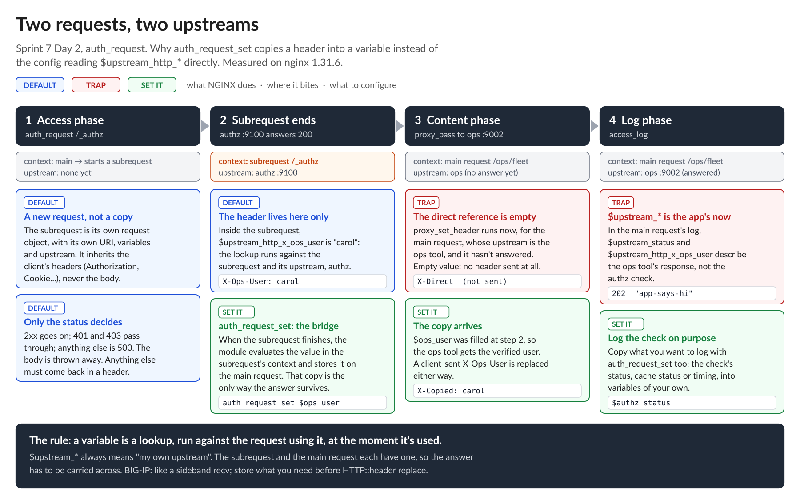

# NGINX Learning Journey, Sprint 7 Day 2: Asking Someone Else with `auth_request`

Day 1's decisions came from a certificate the edge could check by itself. Most access decisions need information the edge doesn't have: who owns this token, what role they have, whether they may do this. On BIG-IP that's an APM per-request policy, or an iRule making a sideband call to an authorization service. NGINX's tool is `auth_request`: before serving a request, ask another HTTP service, and let its status code decide.

It takes a few lines to configure. The nuance is in what NGINX actually sends the service, what it does with the answer, and which request a variable belongs to.

## Two requests, two upstreams

This was the most useful thing I learned today, even though it's a side issue to authorization itself. `auth_request` doesn't forward the client's request. It makes a **subrequest**: a second request inside NGINX, through its own location, with its own upstream.

An NGINX variable isn't a stored value. It's a **lookup, run against the request that uses it, at the moment it's used**. `$upstream_http_x_ops_user` means "the `X-Ops-User` header from *this request's* upstream":
- **In the subrequest,** it's the authorization service's answer: `carol`.
- **In the main request,** `proxy_set_header` runs while NGINX builds the request to the backend, which hasn't answered yet. The direct reference is empty, so the header isn't sent at all.
- **In the access log,** the main request's `$upstream_*` variables describe the backend's response, not the authorization check. I logged `$upstream_cache_status` to watch the decision cache, got `-` on every line, and later missed the quiz question about exactly that.

`auth_request_set $ops_user $upstream_http_x_ops_user;` is the bridge between the two requests. It runs the lookup in the subrequest's context when the check finishes and stores the result on the main request. It looked redundant at first, but nothing else gets the answer across. Plus's `auth_jwt` doesn't need it, because it validates the token inside the main request.

The same root explained my slip in the method activity: I put `X-Original-Method` in the app's location, not the auth location. Each location's `proxy_set_header` only shapes its own upstream request, so the authorization service never saw it.

## Only the status code counts

| The service answers | The client gets |
| :--- | :--- |
| `2xx` | The request goes on |
| `401` | `401`, with the service's `WWW-Authenticate` copied |
| `403` | `403` |
| Anything else: `404`, `302`, `500`, a timeout | `500` |

The body is thrown away, so anything else must come back as a header. A service that's down, slow or misrouted fails **closed**, and its availability becomes the application's. The timeouts in the auth location default to 60 seconds, so set them there deliberately. On BIG-IP, how a sideband failure behaves depends on how you wrote the iRule. NGINX always returns `500`.

## What the service sees by default

The subrequest isn't a copy of the client's request:
- **It inherits every client header:** `Authorization`, but also cookies and everything else.
- **It's always a `GET`.** A viewer's `POST` reached the service as a `GET`, the service saw a read, and allowed it. Pass `X-Original-Method $request_method` and `X-Original-URI $request_uri` yourself. Inside the auth location, those variables still describe the client's request.
- **The body is never sent, but `Content-Length` is.** A service that trusts the header waits for bytes that never come. That's why `proxy_pass_request_body off` and `proxy_set_header Content-Length ""` always appear together.

You control the rest: the method, the URL (variables work in `proxy_pass`), and the headers, which you can add, override, remove, or allow-list with `proxy_pass_request_headers off`. The posture is the reverse of BIG-IP's. A sideband request starts empty and you add what to send. NGINX starts from a copy of everything, and you remove what the service shouldn't see.

## Caching a decision changes the decision

One extra round trip per request is the cost, and `proxy_cache` in the auth location removes most of it. Five requests, one call. Two lessons:
- **The cache key decides whose answer is reused.** With the token as the key, a viewer's cached `GET` decision answered their `POST`. Write access came back without the service being asked. The key must hold every input of the decision: the token **and** the method here, and the URI if decisions differ per path.
- **The lifetime is a revocation delay.** A token revoked at the service keeps working until its cached `200` expires, and a cached `401` keeps refusing a token that was just re-enabled. `proxy_cache_use_stale`, cache headers from the service, and one cache per edge all make the delay longer. Open-source NGINX has no purge to cut it short, unlike `table delete` on BIG-IP. Choose the lifetime as a security decision, not just a performance setting.

## `satisfy any`, and the phase order

`allow`/`deny`, `auth_basic` and `auth_request` all run in the access phase. `satisfy any` turns them into alternatives: the office network **or** a valid token. The office's requests never reached the service at all.

The phase order also explains one silent trap: anything in the rewrite phase runs before the access phase. A `return` in the same location answers without the service being asked, and an `if` on an `auth_request_set` variable sees it empty.

## The con of how I built it: zero trust

The edge checks the token, removes it, and passes `X-Ops-User` and `X-Ops-Role` to the backend. Not forwarding the credential is the right instinct, and it shows off what `auth_request` and `auth_request_set` can do. But the backend now trusts a plain header from anyone who can reach it. Every route to that backend must overwrite the header, the backend can't act on the user's behalf further down, and the edge's cache lifetime becomes the whole system's revocation delay. Fine for a lab. In production, **each leg should verify**: mTLS from the edge to the backend (Day 1's ledger leg), or a short-lived token signed by the edge that the backend checks. BIG-IP's APM-then-header-insert pattern has exactly the same trade-off.

Quiz: 9 out of 10. The one I missed was the log question: `$upstream_cache_status` in the main `log_format` shows `-` because it describes the main request's upstream. Copy the subrequest's value with `auth_request_set`. That's the same lesson as the image above.

## What's next

Day 3: single sign-on. OAuth2 Proxy in front of the staff portal, Keycloak as the identity provider, and `auth_request` doing the asking again, this time to a real SSO session. Then the sprint lab ties all three days together.

#NGINX #F5 #BIGIP #ZeroTrust #Authorization #LearningInPublic #DevOps
