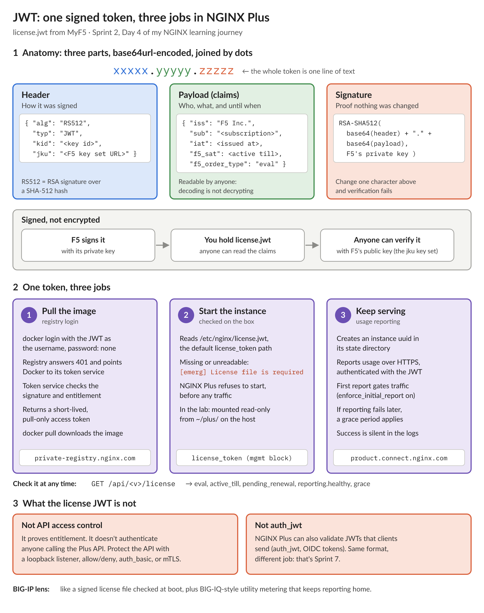

# NGINX Learning Journey, Sprint 7 Day 3: Single Sign-On, Open Source and Plus

Day 3 put Tidewater's staff portal behind Keycloak twice. First with open source NGINX, which doesn't speak OpenID Connect itself, so OAuth2 Proxy does the sign-in and NGINX asks it with Day 2's `auth_request`. Then with NGINX Plus, which does it natively. On BIG-IP both are one APM access profile acting as the OIDC relying party. The difference between the two NGINX versions turned out to be the most useful lesson of the day.

## Open source: NGINX asks, OAuth2 Proxy holds the session

The pattern is Day 2's: each request to `/portal/` makes a subrequest to OAuth2 Proxy's `/oauth2/auth`, which answers `202` with the user as `X-Auth-Request-*` headers, or `401`, which `error_page 401 = @login` turns into the sign-in redirect. The details that weren't obvious:
- **`X-Auth-Request-User` is the `sub`,** Keycloak's internal UUID, not the username. Pass `X-Auth-Request-Preferred-Username`.
- **The session cookie goes to the application** unless you remove it. Anyone who can read the app's logs could replay the session at the edge.
- **Groups are a query string:** `/oauth2/auth?allowed_groups=admins` answers `403` for everyone else, so one extra internal location covers the admin pages.
- **Keycloak behind NGINX needs `X-Forwarded-Port`,** or it advertises `https://localhost/` without the port, and every redirect breaks.
- **Signing out of the proxy isn't signing out.** `/oauth2/sign_out` clears OAuth2 Proxy's cookie, but Keycloak's session survives, and the next sign-in completes without a password. In production, OAuth2 Proxy's `--backend-logout-url` ends the Keycloak session too. A redirect to Keycloak's logout page alone stops at a "Do you want to log out?" confirmation.

## It's still passed trust

I expected OAuth2 Proxy and JWTs to mean the application verifies the user. As the lab is built, it doesn't. OAuth2 Proxy verifies Keycloak's token **once**, at sign-in, and keeps the session in its own encrypted cookie. After that, the portal gets a plain `X-User` header and believes it from anyone who can reach it. That's Day 2's trust model with a better identity source.

So I built a separate throwaway stack where NGINX forwards Keycloak's access token and the application verifies it. A forged `X-User` sent straight to the app was believed; a forged token was rejected. But it took three extra fixes:
- **An audience mapper.** As configured, the access token had no `aud` claim at all, so a correct application rejected it.
- **Token refresh.** Without `--cookie-refresh`, the edge kept serving bob nine minutes after the app started rejecting his expired token. Two components, two clocks.
- **Bigger buffers.** NGINX reads an upstream's response headers into `proxy_buffer_size`, one memory page (4k) by default. A refreshed session cookie of ~3.5 KB overflowed it: `upstream sent too big header`, a `500` for the user. `proxy_buffer_size 16k` alone fails `nginx -t`; it needs `proxy_buffers` raised too.

Verifying at each stop is real protection, and it's three more things to configure.

## Plus: the same portal, one container fewer

NGINX Plus has `oidc_provider` and `auth_oidc`. The sign-in flow, the session and the claims all live inside NGINX:

| | Open source + OAuth2 Proxy | NGINX Plus |
| :--- | :--- | :--- |
| Components | NGINX + OAuth2 Proxy (its own container, cookie secret, ~20 flags) | NGINX |
| NGINX config for sign-in | About 50 lines: 6 locations, including an internal auth location, `@login`, and `auth_request_set` per header | About 17 lines: the provider, the portal, the callback |
| Per-request call to another service | Yes, every request | No |
| Session | An encrypted cookie in the browser (it grows with claims) | NGINX shared memory; the cookie is a short ID |
| Claims to the app | `X-Auth-Request-*` → `auth_request_set` → `proxy_set_header` | `$oidc_claim_*` → `proxy_set_header` |
| API bearer tokens | Not covered: build a validator or write njs | `auth_jwt`, with the IdP's keys fetched and cached |

What that buys, in practice:
- **One fewer thing to fail.** Day 2 showed an `auth_request` service that's down or slow is a `500` for every request. With Plus there's no second hop.
- **No subrequest bridge.** `auth_jwt` and `auth_oidc` work inside the main request, so claim variables are just there. No `auth_request_set`, the lesson from Day 2's image.
- **No cookie-size problems.** The session stays in NGINX, so the buffer overflow above doesn't happen.
- **Real token checks for APIs:** `auth_jwt` verifies the signature against Keycloak's JWKS, `auth_jwt_key_cache` keeps the keys, and `auth_jwt_require` adds the claims: issuer and audience as `map` variables. A correctly signed token issued for `billing-api` got `401` at the dispatch API.
- **Logout is built in** (`post_logout_uri`, `logout_token_hint`) instead of extra proxy flags.

The Plus gotchas were all quiet ones:
- **`auth_jwt_require` alone does nothing.** It adds conditions to a check `auth_jwt` is already running. I put the `auth_jwt` block in the wrong server (the Plus API's `location /api/`, not the dispatch API's), and the dispatch API kept answering `200` to everyone, with `nginx -t` happy.
- **The callback needs its own location:** `location = /oidc_callback { auth_oidc tidewater; }`. Without it, Keycloak's redirect back was served as a file: `404`.
- **The OIDC module refuses an `http://` issuer** at load, so the IdP's front door must be HTTPS.
- **Array claims:** `$jwt_claim_groups` is empty for an array; `auth_jwt_claim_set $jwt_groups groups;` gives `admins,staff`. `$oidc_claim_groups` joins arrays by itself.

## The token that started it

Back in Sprint 2, the first thing NGINX Plus checked was a JWT: its own `license.jwt`, signed by F5.

Today Plus checked other people's: the same structure (header, claims, signature), the same question (who signed this, is it still valid, is it meant for me). That's what made `auth_jwt` click quickly.

## Sprint 7 in one line

Day 1 checked a **certificate** at the door (at the HTTP layer, not in the handshake), Day 2 **asked another service** with `auth_request`, and Day 3 **asked an identity provider**: through OAuth2 Proxy in open source, natively in Plus. Underneath all three is the same question: where is trust checked, and how far does it travel after that?

## My take on open source vs Plus for sign-in

Open source can do everything here, and OAuth2 Proxy is solid. But it's a second service with its own configuration, cookie, clocks and failure modes, and NGINX's part is wiring: subrequests, named locations, variable bridges, buffer sizes. Plus collapses that into a few directives and keeps the session where NGINX can manage it. Coming from APM, the Plus version feels like home: one box owns the sign-in, the session and the claims. If sign-in is the reason you'd add a component, that's a strong case for Plus.

## Quiz: 6 out of 10, then 9 out of 10

No single topic: the misses were spread across the day. Breadth to consolidate, not one gap. The sprint lab passed 10/10 from the end of the activities, since the lab is the week's work added together.

## What's next

Sprint 8: modern Kubernetes ingress.

#NGINX #F5 #NGINXPlus #BIGIP #APM #OpenIDConnect #OAuth2 #ZeroTrust #LearningInPublic #DevOps
