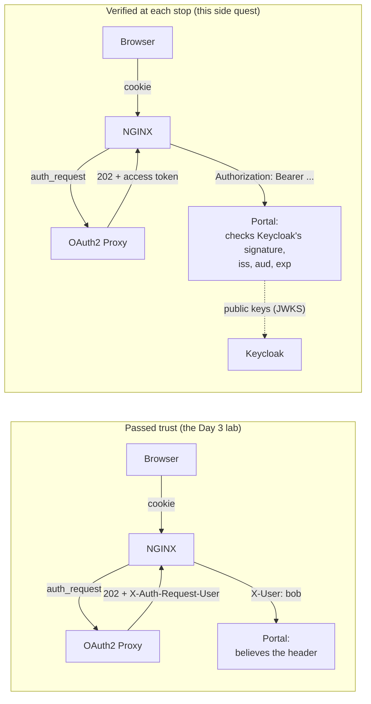

# Side Quest: Zero Trust Past the Edge
**Sprint 7, Day 3 aside.** A throwaway stack, separate from the lab, to see what it takes for the application to verify the user itself instead of believing NGINX.

## Why We Did It
Day 2 and Day 3 use the same pattern: the edge checks the credential once, then sends the application plain headers (`X-Ops-User`, `X-User`). The application believes those headers from anyone who can reach it. OAuth2 Proxy looks like more, because there's an identity provider and JWTs, so the question was:

> Is OAuth2 Proxy just another way of passing trust upstream, or can the application verify trust itself from the token NGINX passes along?

As the lab is built, it's passed trust. OAuth2 Proxy verifies Keycloak's ID token **once**, at the callback, then keeps the session in its own encrypted cookie. Every `/oauth2/auth` after that only decrypts that cookie. No JWT reaches NGINX or the portal; the portal gets `X-User`.

OAuth2 Proxy *can* hand the tokens to NGINX, though, and NGINX can forward them. This side quest measures what happens when it does.



## What We Assumed
Before the experiment, these were the claims (from the Day 3 Q&A in `recap_notes.md`):

| # | Claim | Result |
|---|---|---|
| 1 | `--set-authorization-header` and `--pass-access-token` put the tokens on the auth response, and `auth_request_set` + `proxy_set_header` deliver them to the app. | **Held** |
| 2 | A forged header sent straight to the app works; a forged token doesn't. | **Held** |
| 3 | Forward the access token, not the ID token, and give it an audience with a Keycloak audience mapper. | **Held, and sharper than expected:** the access token had no audience at all |
| 4 | Keycloak's 5-minute access tokens expire before the session; `--cookie-refresh` fixes that. | **Half right:** the expiry gap is real, but `--cookie-refresh` alone breaks the page |
| 5 | Large tokens can overflow `proxy_buffer_size` on the auth response. | **Right problem, wrong place first:** sign-in broke before the auth response did |

## What Really Happened
Versions: `nginx:mainline` 1.31.6, OAuth2 Proxy v7.15.6, Keycloak 26.8.2, a copy of the lab realm with the access-token lifespan cut to 60 s. The app (`app.py`) is stdlib Python. It reports `X-User` as received, and checks both tokens: RS256 signature against Keycloak's JWKS, then `iss`, `exp`, and `aud: portal-app`.

### 1. The tokens reach the app
`/oauth2/auth` answered `202` with `Authorization: Bearer <ID token>` and `X-Auth-Request-Access-Token`, about 1.1 KB each for bob. NGINX copied them with `auth_request_set` (Day 2's bridge between the subrequest and the main request) and sent the access token on as `Authorization` and the ID token as `X-Id-Token`. Both signatures checked out at the app.

### 2. Forgery, sent straight to the app
From inside the network, bypassing NGINX:
* `X-User: alice` → believed as-is.
* Bob's token with `preferred_username` edited to `alice` (and `aud` set to `portal-app`) → `rejected: bad signature`.

This is the whole point. A header proves only that someone could reach the app. A token proves that Keycloak said so.

### 3. Audience: the access token had none
With the realm as the lab configures it:
* ID token: `aud: portal`, the client. It's meant for OAuth2 Proxy, not for an API.
* Access token: **no `aud` claim at all** (only `azp: portal`).

Both failed an app that requires `aud: portal-app`. After an audience mapper on the `portal` client (`realm-audience.json`: `oidc-audience-mapper`, `included.custom.audience: portal-app`, access token only) and a new sign-in, the access token carried `aud: portal-app` and passed; the ID token still failed. An app that skips the audience check accepts any token Keycloak issued in that realm, for any client.

### 4. Expiry: the edge and the app disagree
Without `--cookie-refresh`, the edge kept answering `200` about 9 minutes after the token expired. OAuth2 Proxy's cookie lives 168 hours by default. Meanwhile the app answered `rejected: expired` from the first minute. The edge says bob is signed in; the app says he isn't.

With `--cookie-refresh=30s`, OAuth2 Proxy refreshed on the first request after 30 s and the app saw a fresh token, but only after two NGINX changes:
1. **Bigger buffers.** The refresh adds a ~3.5 KB `Set-Cookie` to the auth response. With the default `proxy_buffer_size` (4k): `upstream sent too big header` → auth `502` → the user gets a `500`.
2. **Pass the new cookie to the browser.** `auth_request_set $sso_cookie $upstream_http_set_cookie;` + `add_header Set-Cookie $sso_cookie;`. Without it the tokens stayed valid, but the browser kept the old cookie, so OAuth2 Proxy refreshed **on every request**: one Keycloak call per page.

<details>
<summary>Why doesn't the new cookie reach the browser on its own?</summary>

Because it's on the **subrequest's** response. `auth_request` keeps only the status of the auth response; its headers are discarded unless `auth_request_set` copies them, the same reason Day 2 needed `auth_request_set` for `X-Ops-User`. The main response comes from the portal, so NGINX has to add the cookie to it.
</details>

### 5. Header size: sign-in broke first
Bob with 2 groups: auth response 2.6 KB, inside the default 4k until a refresh adds the cookie. Bob with 40 long group names (added by hand in Keycloak's admin console): tokens 3.3 KB each, the session cookie split into `_tidewater_sso_0` and `_1`, and the auth response reached 8.5 KB. The **callback** failed first (`502` on `/oauth2/callback`, through the plain `location /oauth2/`), then `/oauth2/auth` at 8k.

The fix was `proxy_buffer_size 16k; proxy_buffers 8 16k;` on both locations. `proxy_buffer_size 16k` alone fails `nginx -t`: `"proxy_busy_buffers_size" must be less than the size of all "proxy_buffers" minus one buffer`, because the default `proxy_buffers` is `8 4k`.

### What it took, in one diff
`nginx.baseline.conf` is the first working version (tokens forwarded). `nginx.conf` is the final one:

```diff
-        location /oauth2/ { ... proxy_pass http://sso; }
+        location /oauth2/ { ... proxy_pass http://sso; proxy_buffer_size 16k; proxy_buffers 8 16k; }
         location = /oauth2/auth {
             ...
+            proxy_buffer_size 16k; proxy_buffers 8 16k;
         }
         location /portal/ {
             ...
+            auth_request_set $sso_cookie $upstream_http_set_cookie;
+            add_header Set-Cookie $sso_cookie;
             proxy_pass http://portal;
         }
```
Plus, outside NGINX: an audience mapper in Keycloak, `--cookie-refresh` on OAuth2 Proxy, and an app that verifies.

## The Trade-offs of Practical Zero Trust
Verifying at each stop is real protection, and it isn't free. What the experiment showed, and what follows from it:

**What you gain**
* **The network stops being the credential.** Anyone on `s7-net` can type `X-User: alice`; nobody can sign a token without Keycloak's key.
* **Mistakes at the edge stop being fatal.** A forgotten `location` that passes the client's `X-User` through is a breach with headers; with tokens, the app still rejects it.
* **Expiry comes with the credential.** A stolen header works forever; a stolen access token works until `exp` (60 s here, 5 minutes by default).
* **The app can pass the user on.** It holds a real credential it can send to the next service, which can verify it too. A header can't be delegated.

**What it costs**
* **More moving parts to agree.** The edge, OAuth2 Proxy and the app each decide whether bob is signed in, using different clocks (cookie 168 h, token 60 s–5 min). Section 4 is what disagreement looks like: a page that loads at the edge and fails at the app.
* **Configuration in three places.** Keycloak (audience mapper, token lifespan), OAuth2 Proxy (`--pass-access-token`, `--set-authorization-header`, `--cookie-refresh`) and NGINX (buffers, cookie pass-through). Missing any one is a silent failure or an outage.
* **Load on the identity provider.** Short tokens mean refreshes. With the cookie not passed back, that was one Keycloak call per request.
* **Header size becomes an operations problem.** Tokens grow with claims (groups especially), and the failures show up as `502`s at sign-in, not as auth errors.
* **Every app needs a verifier.** JWKS fetching and caching, key rotation, clock skew, and checking `aud` and `iss`, not just the signature. An app that checks only the signature accepts tokens for other clients.
* **It's still a bearer token.** Whoever holds it can use it until `exp`. Binding it to the client (mTLS-bound tokens, DPoP) is the next step, with its own cost.

**Practical middle grounds**
* **Network controls plus headers**: only the edge can reach the app (network policy), and the app keeps believing `X-User`. Cheapest; trust still sits in the network.
* **mTLS edge → app** (Day 1's ledger leg): the app knows it's talking to the edge, so the headers come from the only component allowed to set them. Doesn't protect against a compromised edge.
* **Verify at the edge and again at the app**: NGINX Plus `auth_jwt` (Day 3 side quest) or njs checks the token at the edge and forwards the same token. Bad tokens stop early, and the app doesn't have to trust NGINX.
* **Short-lived edge-issued token**: the edge signs its own token for the app. The app verifies one issuer (the edge) instead of the IdP. The edge's key becomes the most valuable secret on the box.

<details>
<summary>Which of these would you pick for Tidewater's staff portal, and why?</summary>

There's no single answer. A reasonable one: **mTLS edge → portal plus headers**, because the portal sits on an internal network, only the edge should ever call it, and Day 1 already built the certificate infrastructure. Move to **forwarded access tokens** once the portal calls other services on the user's behalf, because then the user's identity has to travel beyond the edge, and a header can't be delegated safely.
</details>

## BIG-IP Delta
* **The lab** is APM session variables + an HTTP header insert: APM verifies once, the pool member believes the header.
* **This side quest** is APM forwarding the OAuth token to the backend. APM has OAuth bearer SSO for that; the backend verifies.
* **The refresh mismatch** maps to APM's access session lifetime vs. the IdP token's lifetime: the same two clocks, owned by one box instead of three components.
* **Buffer sizes:** the HTTP profile's **Maximum Header Size** defaults to 32 KB, so these 8.5 KB responses wouldn't need tuning there. NGINX's `proxy_buffer_size` defaults to one memory page (4k here), so NGINX hits the limit much earlier.

## Run It Yourself
Everything runs in its own network (`zta-s7`, 10.89.0.0/24) on ports 8088 (edge) and 8089 (Keycloak admin, user `admin` / `admin-lab`). It doesn't touch the Sprint 7 lab.

| File | What it is |
|---|---|
| `up.sh` / `down.sh` | Start and remove the stack. Extra arguments to `up.sh` go to OAuth2 Proxy (it's recreated each time). |
| `nginx.baseline.conf` / `nginx.conf` | The edge before and after the fixes. |
| `realm.json` / `realm-audience.json` | The lab realm (60 s tokens), without and with the audience mapper. |
| `app.py` | The portal: reports `X-User` and verifies both tokens. |
| `login.sh`, `portal.sh`, `probe.sh` | Sign in with curl, call the portal, watch the token expire over ~2.5 minutes. |

```bash
cd sprints/sprint-7/zta-side-quest

# 1-3. Tokens, forgery, audience (no mapper: access token "rejected: aud is not portal-app")
./up.sh && ./login.sh bob && ./portal.sh
docker run --rm --network zta-s7 curlimages/curl -s -H 'X-User: alice' http://10.89.0.20:9003/portal/
./down.sh
REALM=realm-audience.json ./up.sh && ./login.sh bob && ./portal.sh     # access token: valid

# 4. Expiry without, then with, refresh
./probe.sh                                     # edge 200, app "expired" after 60 s
./down.sh; REALM=realm-audience.json CONF=nginx.baseline.conf ./up.sh --cookie-refresh=30s
./login.sh bob && ./probe.sh                   # 500s once the refresh cookie overflows the buffer
./down.sh; REALM=realm-audience.json ./up.sh --cookie-refresh=30s
./login.sh bob && ./probe.sh                   # fresh tokens, the app stays "valid"
./down.sh
```
Section 5 needs extra groups on bob: add them in the admin console at `http://localhost:8089` (only reachable from the lab box), then sign in again with the baseline config.
